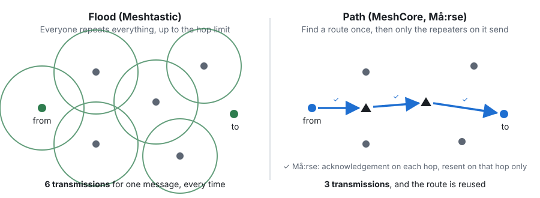
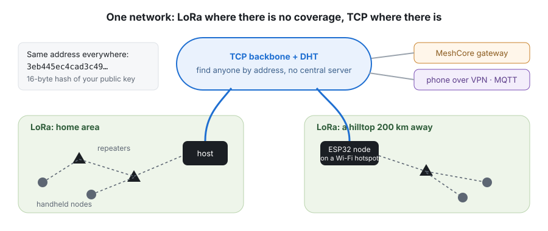
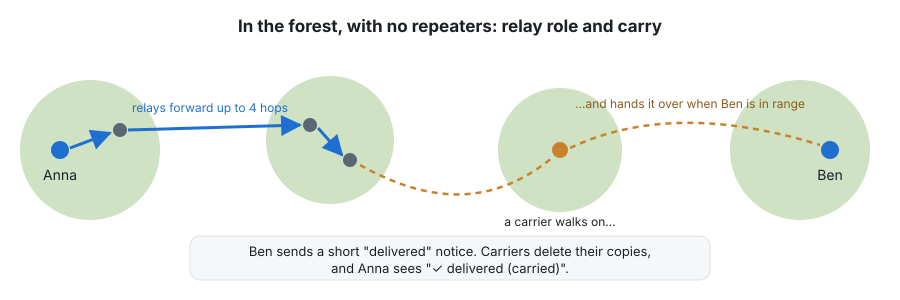
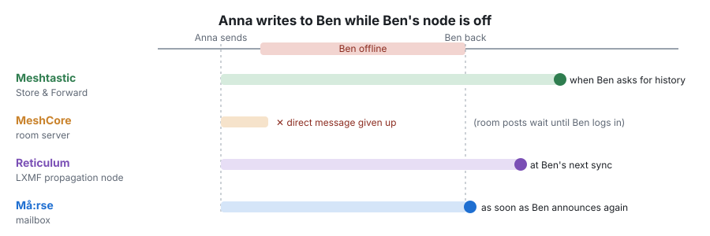

# Må:rse

**An encrypted LoRa mesh that runs on the radio itself and reaches the rest of the world when it can.**

Må:rse (say "more-seh") sends text, pictures, voice messages and small web-like pages between cheap LoRa radios, with no mobile network and no central server. Where there is internet, the same network carries on over TCP, so a message from a forest in Jutland can reach a friend in Oslo. It works the same way end to end, with the same address and the same encryption.

It borrows the best ideas from three existing projects. From **Meshtastic** it takes plug-and-play, from **MeshCore** efficient repeater routing, and from **Reticulum** identity and global reach. It is written in Rust and runs directly on the microcontroller.

> **Status:** a working prototype (v0.5). It runs on Heltec V4 (ESP32-S3) and Seeed XIAO nRF52840 boards, a PC host, a web client and an Android app. Range and power have not been measured in the field yet, and the cryptography has not been reviewed by outsiders.

**[▶ Try the simulator](docs/simulator/index.html)**: compare Meshtastic, MeshCore, Reticulum and Må:rse in your browser · **[Technical guide](docs/GUIDE.md)** · **[Detailed comparison](compare.md)**

---

## What you can do with it

| | |
| --- | --- |
| 💬 **Messages** | End-to-end encrypted direct messages with "delivered" receipts and forward secrecy. Public channels, `#hashtag` channels, private channels and regional channels (`name@region`). |
| 📦 **Mailbox** | A message to someone whose node is off waits on the host or in a repeater's flash. It is delivered by itself when they come back. |
| 🖼️ **Files and voice** | Pictures and files up to 8 KB over LoRa and 1 MB over the internet. Voice messages use Codec2 at 1200 bit/s, and calls use Opus over TCP. |
| 🌐 **Internet backbone** | Hosts link up over TCP and find each other in a distributed hash table (DHT). An ESP32 node can join over Wi-Fi, for example on a phone hotspot on a hilltop. |
| 📄 **`maarse://` pages** | Small compressed pages served from a host, like a tiny web. They are not HTML, so a page can never run code on your device. |
| 🌲 **Forest mode** | With no repeaters around, handheld nodes relay for each other. A message can also be *carried* by people walking until it reaches the recipient. |
| 🔁 **Gateway to MeshCore** | Bridges a Må:rse channel and a MeshCore channel both ways, tried on hardware. |
| 🏠 **Home Assistant** | An MQTT bridge with auto-discovery for battery, position and telemetry. |
| 🔐 **Identity** | Your address is a 16-byte hash of your public key. Back it up with a 24-word recovery phrase, and compare safety numbers by QR code. The sender is never sent in clear text. |
| 🛠️ **Operations** | Signed firmware updates over USB, Bluetooth and the network. The host runs as a service with a live log page and a Windows tray icon. Repeaters can be managed remotely by administrators. |

---

## How it works

### Find a route once, then follow it

<p align="center"></p>

Meshtastic **floods**: every node repeats every packet, up to a hop limit (3 by default, 7 at most). That needs no planning and copes with anything moving. But every message costs airtime on every node, and in a busy area the copies collide.

Må:rse, like MeshCore, floods only a small **path request**. Each repeater adds itself to the request. The recipient picks the copy with the **best signal (SNR)**, not just the first to arrive, and sends the path back. After that, messages follow that path, and only the repeaters on it transmit. Må:rse also gets an **acknowledgement on every hop**. A lost packet is resent on that one hop instead of from the start, and a broken path is repaired. On long roads, **anchor repeaters** split paths over 12 hops into pieces, for up to 64 hops in total.

### One network over radio and internet

<p align="center"></p>

LoRa is slow, at a few hundred bytes per second, but it reaches kilometres with no infrastructure. TCP is fast, but only where there is a connection. Må:rse treats both as links in the same network. A **host** (`maarse-host` on a PC or Raspberry Pi) or a **Wi-Fi-connected ESP32 node** joins a LoRa area to the TCP backbone. To reach an address it does not know, a host looks it up in the **DHT** and connects straight to the gateway behind it. There is no central server, and the internet hop costs no LoRa airtime.

---

## Four scenarios

Each scenario below can be run in the **[simulator](docs/simulator/index.html)**, where you can change the settings and watch a message travel. The numbers in this README come from `maarse-sim`, the project's own simulator, which runs the real Må:rse router code.

### 🛣️ On the motorway

*A 210 km drive on the E45, repeaters on masts, cars at 110 km/h.*

- **Meshtastic:** the road is longer than flooding can reach. With a hop limit of 3 a message dies halfway, and 7 hops is not enough either.
- **MeshCore:** fine while the path holds. But the cars move, the learned path breaks, and the next message starts over with a flood.
- **Reticulum:** paths come from announces, which have to spread again after every move. On a slow LoRa channel that is expensive.
- **Må:rse:** the per-hop acknowledgement notices a broken hop at once and repairs the route. Moving nodes are marked as mobile and are not used as relays. Anchor repeaters carry paths beyond 12 hops. In `maarse-sim`, with repeaters every 15 km at SF9, **85 %** of messages arrive. With *carry* turned on, **94 %** arrive.

### 🌲 In the forest

<p align="center"></p>

*18 people in three groups spread over 8–10 km of forest. No repeaters, and the trees cut the range to about 1.5 km.*

- **Meshtastic** is at its best here. Every node repeats, so messages hop from group to group.
- **MeshCore** and **Reticulum** forward only through repeaters or transport nodes, which are off on handhelds by default. You reach only the people you can hear yourself.
- **Må:rse** has a **relay role**. Handhelds forward for up to 4 hops when no repeater is around, and they wait a little so a real repeater would win. With **carry**, people who walk on take a copy along. When the recipient gets it, a short "delivered" notice stops the other copies, and the sender sees *delivered (carried)*.

From `maarse-sim`, average of 10 seeds:

| Forest | Delivered | Airtime |
| --- | --- | --- |
| 8 km, no carry | 59.5 % | 368 s |
| 8 km, carry (4 copies) | **75.7 %** | 401 s (+9 %) |
| 10 km, no carry | 30.0 % | 305 s |
| 10 km, carry (4 copies) | **44.2 %** | 339 s (+11 %) |

### 🏙️ In a dense city

*Over 100 nodes in the streets, a dozen rooftop repeaters, many people writing at once.*

- **Meshtastic:** every message is sent by many nodes, and the copies collide with each other and with the next messages. The busier it gets, the more is lost.
- **MeshCore and Må:rse:** after the first path request, only a handful of rooftop repeaters send each message. In `maarse-sim`'s comparison runs, Må:rse uses about **a third of the airtime** of a flood for the same messages.
- **Må:rse** also keeps channels local with **regions**, so a `#city@aarhus` chat does not travel to the other end of the country. Proof-of-work stamps on announces and path requests make flooding the network with spam expensive.

### 🌾 Out in the countryside

*Farms 5–10 km apart, a few high repeaters, SF11 for range, where every packet takes most of a second.*

- **Meshtastic:** corner to corner is 4–6 hops, more than the default limit. Raising the limit multiplies the copies on an already slow channel.
- **Reticulum:** announces and path lookups are what LoRa can least afford at SF11.
- **MeshCore and Må:rse:** a path through the repeaters. Må:rse picks the strongest links, so fewer packets have to be resent. If two farms have internet, Må:rse sends between them over the backbone and keeps the slow radio for the last few kilometres.

### 📬 Room server, propagation node or mailbox

<p align="center"></p>

The recipient's node is switched off. What happens to the message?

- **Meshtastic, Store & Forward:** a router with extra memory keeps messages and replays them when the recipient asks for the history.
- **MeshCore, room server:** a bulletin board. Posts in a room wait until you log in to it. A *direct* message to someone offline is resent for a while and then given up.
- **Reticulum, LXMF propagation node:** messages wait on the node until the recipient's app syncs with it.
- **Må:rse, mailbox:** the message waits on the sender's host (on disk for 7 days, files too) or in a repeater's flash. It is delivered **by itself the moment the recipient announces again**, with nothing to log in to and no sync interval. The sender then sees *delivered from mailbox*. A phone away from home can use its home host's mailbox over VPN.

---

## Side by side

| | Meshtastic | MeshCore | Reticulum | **Må:rse** |
| --- | --- | --- | --- | --- |
| Routing | Managed flood | Flood, then a learned path | Announces, next hop | Path request, then the best-SNR path with per-hop acknowledgements |
| Max hops | 7 | 64 | 128 | 64 (over 12 with anchors) |
| Who forwards | Everyone | Repeaters | Transport nodes | Repeaters, plus relays in forest mode |
| Internet | MQTT server | Third-party bridges | TCP, UDP, I2P… | TCP backbone + DHT, MQTT, MeshCore gateway |
| Offline recipients | Store & Forward (on request) | Room servers | Propagation nodes (sync) | Automatic mailbox |
| Files / voice | No / no | No / no | Yes / calls | 8 KB on LoRa, 1 MB on TCP / Codec2 messages, Opus calls |
| Runs on the radio chip | Yes | Yes | No (needs Python) | Yes (Rust, no heap) |
| Maturity | Large, many years | Growing fast | Mature, 1.x | **Prototype** |

The full comparison, including pros and cons of each, is in [compare.md](compare.md).

**To be fair:** Meshtastic, MeshCore and Reticulum have what counts most in practice: thousands of users, polished apps and years on the air. Må:rse is a prototype with two boards on a desk. What it offers is a design that combines their strengths, and it is open (MIT or Apache-2.0) for anyone who wants to help prove it.

---

## Get started

```text
1. Install Rust: https://rustup.rs
2. Start a host with the web client:
     Windows:  scripts\start-host.bat
     Linux:    ./scripts/start-host.sh
3. The browser opens http://127.0.0.1:8080 and connects.
```

To flash a radio, run `scripts/build-firmware.ps1 <board> -Flash` on Windows or `scripts/build-firmware.sh <board> flash` on Linux. The boards are `heltec-v4`, `xiao-esp32s3`, `xiao-nrf52840` and `wismesh-tag`. Then connect to it from the web client over USB or Bluetooth.

The **[technical guide](docs/GUIDE.md)** covers everything else: the host's options, running it as a service, the Wi-Fi backbone, the Android app, the protocol details, the test lab and the release process.

## The simulator online

`docs/simulator/index.html` is a single self-contained page. To run it from GitHub, turn on **Settings → Pages → Deploy from branch → `/docs`**, and it will be at `https://<user>.github.io/<repo>/simulator/`. It is a simplified model for building intuition. For real numbers, use `maarse-sim`, which runs the actual router code:

```text
cargo run --release -p maarse-sim -- --forest --nodes 18 --role relay --carry 4
```

## Licence

Code under MIT or Apache-2.0, at your option. The specification is under CC-BY 4.0.
