<div align="center">

# Må:rse

**Text, pictures and voice between cheap LoRa radios, with no mobile network and no central server.<br>When there is internet, the same network carries on around the world.**

[**▶ Open the Mesh Lab**](https://trixxor.github.io/maarse/simulator/): race Må:rse against Meshtastic, MeshCore and Reticulum in your browser
· [Denmark simulator](https://trixxor.github.io/maarse/denmark/): build and break a national network, real router code in WebAssembly ([how it works](docs/denmark/README.md))
· [Technical guide](docs/GUIDE.md) · [Full comparison](compare.md)

  



</div>

## Må:rse in 30 seconds

- **A radio in your pocket.** A €20–40 LoRa board talks to your phone over Bluetooth and to other boards over several kilometres. No SIM card and no subscription.
- **Messages find their own way.** Repeaters on rooftops and hills pass messages along a route chosen for its signal quality. Every hop confirms that it got the packet, so lost packets are resent on the spot.
- **Nobody needs to be online at the same time.** A message for someone whose radio is off waits in a mailbox. When they come back, it is delivered by itself.
- **Radio where there is no coverage, internet where there is.** A home computer or a Wi-Fi-connected board joins its radio area to an internet backbone. Your address and your encryption stay the same everywhere.
- **Private by design.** Your address is a hash of your public key, messages are end-to-end encrypted, and the sender's address is never sent in clear text.

> **Honest status:** Må:rse is a working prototype (v0.5). It runs on two boards on a desk, a PC host, a web client and an Android app. It has not been measured in the field yet, and the cryptography has not been reviewed by outsiders. Meshtastic, MeshCore and Reticulum are mature projects with real users. Må:rse is an attempt to combine their best ideas.

---

## Why another mesh?

There are already three good open LoRa mesh projects. Each made a different trade-off:

| | The idea | Great at | Struggles with |
| --- | --- | --- | --- |
| **Meshtastic** | Everyone who hears a message shouts it on, like a town crier. | Zero planning; works while everyone moves. | Airtime and batteries in large or busy meshes; at most 7 hops. |
| **MeshCore** | Relay runners at fixed posts: only repeaters pass messages on, along a learned route. | Efficient, long chains of repeaters. | Places with no repeaters; no built-in internet link. |
| **Reticulum** | A full postal network with addresses, over any medium. | Cryptography, identity, global reach. | Needs a computer or phone; announces use a lot of slow LoRa airtime. |
| **Må:rse** | Relay runners who sign for every handover, with post-office boxes and an internet express train. | Combining the three: efficient routing on the radio chip, global reach, mailboxes. | Being new: no users, no field data yet. |

---

## How it works

### 1. Find the route once, then follow it

<p align="center"></p>

A **flood** makes every node that hears a message repeat it. It is simple and robust, but every message costs airtime on every node. In a busy area, the copies start colliding.

Må:rse floods only a small **path request**. Every repeater it passes adds itself to it. The recipient picks the copy whose links had the **best signal**, not simply the first copy to arrive, and sends the route back. After that, messages follow the route, and only the repeaters on it transmit. MeshCore works in a similar way.

### 2. Confirm every hop, not just the end

<p align="center"></p>

On a long route, some packets get lost: a truck drives past or two radios talk at once. If only the recipient confirms delivery, a loss on hop 3 means starting over from the sender. In Må:rse **every hop confirms**. A lost packet is resent right there, and a broken repeater is noticed at once, so the route is repaired before the user notices.

### 3. Radio and internet are one network

<p align="center"></p>

LoRa is slow, a few hundred bytes per second, but it reaches kilometres without any infrastructure. The internet is fast but only exists where there is a connection. In Må:rse both are just links. A **host** (a PC or Raspberry Pi running `maarse-host`) or an **ESP32 board on Wi-Fi** connects its radio area to the backbone. To reach someone far away, the host looks them up in a **distributed hash table (DHT)** and sends straight to the host near them. There is no central server, and only the recipient's area is woken up.

The design choices are tested in a [simulator of a national network](docs/denmark/README.md) running the real routing code: with today's settings 96 % of messages arrive nationally, and 98 % of a traveller's mail reaches Bornholm with the internet down.

---

## Eight situations, side by side

Every situation can be replayed in the **[Mesh Lab](https://trixxor.github.io/maarse/simulator/)**. There you can race one message on four maps at once, knock out a repeater, switch Må:rse's features off one by one, and see why each message was lost.

<details open>
<summary><b>🛣️ On the motorway</b>: long roads and moving cars</summary>

Repeaters stand on masts every 15 km, and cars drive at 110 km/h.

- **Meshtastic:** the road is longer than a flood can reach. With the default hop limit, a message dies halfway.
- **MeshCore:** works while the route holds. When a car has moved on, the route breaks, and that is only noticed when no acknowledgement comes back.
- **Må:rse:** the broken hop is noticed at once and the route repaired. *Anchor* repeaters carry routes past 12 hops. With *carry*, the car itself takes the message along until it can deliver it.
- **Measured in `maarse-sim`** (the real router code, a 210 km drive on the E45, repeaters every 15 km at SF9): **85 %** delivered, and **94 %** with carry.

[Try it in the Mesh Lab →](https://trixxor.github.io/maarse/simulator/#motorway)
</details>

<details open>
<summary><b>🌲 In the forest</b>: no repeaters at all</summary>


Eighteen hikers in three groups, trees cutting the range to about 1.5 km, and no repeaters.

- **Meshtastic** is good here: everyone repeats.
- **MeshCore** and **Reticulum** forward only through repeaters or transport nodes, so you reach only the people you can hear yourself.
- **Må:rse** handhelds switch to **relay role** when they hear no repeater. They forward for up to 4 hops, and wait a moment first so a real repeater would win. What still cannot get through is **carried** by people walking and handed over when they meet the recipient. A tiny "delivered" notice stops the other copies.

From `maarse-sim`, average of 10 runs:

| Forest | Delivered | Airtime |
| --- | --- | --- |
| 8 km, no carry | 59.5 % | 368 s |
| 8 km, carry | **75.7 %** | 401 s (+9 %) |
| 10 km, no carry | 30.0 % | 305 s |
| 10 km, carry | **44.2 %** | 339 s (+11 %) |

[Try it in the Mesh Lab →](https://trixxor.github.io/maarse/simulator/#forest)
</details>

<details>
<summary><b>🏙️ In a dense city</b>: many people, busy channel</summary>

Street-level radios reach about a kilometre, and rooftop repeaters see further. In a flood, every message is sent by dozens of nodes, and every handheld spends battery repeating other people's messages. MeshCore and Må:rse send most traffic along a few rooftops. Må:rse keeps local chats local with **regions** (`#city@aarhus` does not travel across the country). **Proof-of-work stamps** on announces and path requests make spamming the network expensive.

*The honest part:* in the city, MeshCore and Må:rse deliver about equally well. MeshCore's flooded first message is hard to beat when every node is close to a repeater.

[Try it in the Mesh Lab →](https://trixxor.github.io/maarse/simulator/#city)
</details>

<details>
<summary><b>🌾 In the countryside</b>: long hops, slow packets</summary>

Farms lie 5–10 km apart, with a few high masts. SF11 gives the range, but each packet takes more than a second. Corner to corner is 4–6 hops, more than Meshtastic's default limit, and raising the limit multiplies the copies. Må:rse picks the strongest links, and with internet at two farms it sends long trips over the backbone. That keeps the slow radio for the last few kilometres.

[Try it in the Mesh Lab →](https://trixxor.github.io/maarse/simulator/#country)
</details>

<details open>
<summary><b>📬 Your friend's radio is off</b>: room server, propagation node or mailbox</summary>


- **Meshtastic, Store & Forward:** a router keeps messages; the recipient has to ask for the history.
- **MeshCore, room server:** a bulletin board. Posts wait for you, but a *direct* message to someone offline is given up after a while.
- **Reticulum, propagation node:** messages wait until the recipient's app syncs.
- **Må:rse, mailbox:** the message waits on the sender's host (7 days, files too) or in a repeater's flash. It is delivered **the moment the recipient announces again**. There is nothing to log in to and no sync interval, and the sender sees *delivered from mailbox*.

[Try it in the Mesh Lab →](https://trixxor.github.io/maarse/simulator/#mailbox)
</details>

<details>
<summary><b>🎪 At a festival</b>: a crowd squeezed into one field</summary>

Everyone is within a few hops, so every design delivers something. The difference is the cost. A flood makes nearly every handheld transmit for every message: batteries drain and the channel stays busy. With path routing, only the four light-tower repeaters carry the traffic. In the EU's 1 % duty-cycle bands, flooding nodes simply run out of transmit time.

[Try it in the Mesh Lab →](https://trixxor.github.io/maarse/simulator/#festival)
</details>

<details>
<summary><b>⛈️ In a storm blackout</b>: repeaters fail</summary>

Power is out, the mobile network is down, and the repeaters in the middle of town have failed. A flood degrades gracefully, because it does not care which repeaters are left. Path designs must notice that a route is gone. Må:rse notices at the broken hop and repairs at once. A host with battery backup and a fibre line can still join the two halves of town over the internet.

[Try it in the Mesh Lab →](https://trixxor.github.io/maarse/simulator/#blackout)
</details>

<details>
<summary><b>🌍 Aarhus ↔ Oslo</b>: three cities, one network</summary>

No radio reaches across the sea. Meshtastic can bridge through an MQTT server, but every gateway republishes every packet into its own city. MeshCore has no built-in internet link. Reticulum connects over TCP, but its path requests and announces go out over every city's radios. **Må:rse asks the DHT which host can reach the recipient and sends only there.** The other cities' radios stay quiet.

[Try it in the Mesh Lab →](https://trixxor.github.io/maarse/simulator/#oslo)
</details>

---

## What a listener can read

Someone with a radio receiver and no keys can read this from a direct message:

| | Readable without a key |
| --- | --- |
| Meshtastic | Sender and recipient node numbers, packet id, channel hash, hop counts |
| MeshCore | Short hashes of recipient and sender, and the repeaters on the path |
| Reticulum | The recipient's destination hash; no sender address |
| **Må:rse** | The recipient's 16-byte address and the path; **the sender is never in the header** |

---

## What you can do with it today

| | |
| --- | --- |
| 💬 **Messages** | End-to-end encrypted direct messages with delivery receipts and forward secrecy. Public, `#hashtag`, private and regional channels. Short chat messages are compressed (about 40 % smaller). |
| 🚨 **Public alerts** | Signed warnings from trusted issuers, like cell broadcast but over the mesh: a separate issuer key, certificates from a root key that limit what an issuer may send, expiry and serial numbers against replays, exercise and test status, update and cancel. Shown as a banner that no chat message can imitate. |
| 📦 **Post offices** | Mail for people who are offline is kept by hosts (three copies spread over the backbone) and carried by repeaters. Your node fetches it when it comes back, wherever you are, also over LoRa when the internet is down. |
| 🖼️ **Files and voice** | Pictures and files up to 8 KB over LoRa and 1 MB over the internet; Codec2 voice messages; Opus calls over TCP. |
| 📡 **LoRa trunks** | Long-distance LoRa links with directional antennas between hosts (e.g. Aarhus–Zealand, Zealand–Bornholm) as a backup when the internet is down, on the same frequency and settings as everyone else. |
| 🧭 **Dedicated server** | `maarse-server` for a VPS or any Windows or Linux machine with an open port: hosts find each other through it, hosts behind NAT are relayed, it keeps mail copies, and an admin dashboard shows telemetry for everything passing through (node census with map, destinations, routes, delivery times, modem counters, live traffic). |
| 🌐 **Backbone** | TCP and UDP links between hosts with a DHT, plus serial lines and KISS TNCs (serial or TCP, e.g. Direwolf); ESP32 boards can join over Wi-Fi (a phone hotspot on a hilltop is enough). |
| 📄 **`maarse://` pages** | Tiny compressed pages served from a host. Not HTML, so a page can never run code on your device. |
| 🌲 **Forest mode and carry** | Handheld relays when there are no repeaters, and edge bridges: the person on the hill who hears a repeater relays for the group. Messages carried by people on the move. |
| 🤝 **Neighbours and keys** | Small hello packets tell neighbours roles and coverage within seconds; a node asks the network for a key it lacks; contacts you talk to are pinned and kept in flash; cars say they move so routes to them are refreshed. |
| 🔁 **Gateway to MeshCore** | Bridges a Må:rse channel and a MeshCore channel both ways, tried on hardware. |
| 🏠 **Home Assistant** | MQTT bridge with auto-discovery for battery, position and telemetry. |
| 🔐 **Identity** | 24-word recovery phrase, encrypted backup, safety numbers with QR codes. |
| 🛠️ **Operations** | Signed firmware updates over USB, Bluetooth and the network. The host runs as a service with a live log page and a Windows tray icon. Repeaters can be managed remotely by administrators. |

**Hardware:** Heltec V4 (ESP32-S3) and Seeed XIAO nRF52840 with Wio-SX1262 are tested; Seeed XIAO ESP32-S3 and RAK WisMesh Tag are supported but not yet tried. Phones connect over Bluetooth or USB using the web client or the Android app.

---

## Get started

```text
1. Install Rust: https://rustup.rs
2. Start a host with the web client:
     Windows:  scripts\start-host.bat
     Linux:    ./scripts/start-host.sh
3. The browser opens http://127.0.0.1:8080 and connects.
4. To reach hosts elsewhere: --peer <a backbone node>:4242, or run your own
   with maarse-server --public-addr <your address>:4242 (dedicated server
   with an admin dashboard, docs/GUIDE.md).
   On Debian/Ubuntu: sudo bash scripts/install-server.sh installs it as a
   service and asks for the settings.
```

To flash a radio, run `scripts/build-firmware.ps1 <board> -Flash` on Windows or `scripts/build-firmware.sh <board> flash` on Linux, with `heltec-v4`, `xiao-esp32s3`, `xiao-nrf52840` or `wismesh-tag`. Then connect from the web client over USB or Bluetooth. Everything else (host options, running it as a service, Wi-Fi backbone, Android app, protocol details, test lab, releases) is in the **[technical guide](docs/GUIDE.md)**.

---

## FAQ

<details><summary><b>Can Må:rse talk to Meshtastic or MeshCore radios?</b></summary>
Not directly; they are different protocols. A host can bridge a Må:rse channel and a MeshCore channel both ways (tried on hardware). There is no Meshtastic bridge.
</details>
<details><summary><b>Do I need the internet?</b></summary>
No. Radios talk to each other directly and through repeaters. The internet only joins areas that radio cannot reach.
</details>
<details><summary><b>Is it legal?</b></summary>
Må:rse uses 869.525 MHz in the EU band 869.4–869.65 MHz, where each device may transmit up to 10 % of the time. The firmware enforces the duty cycle and listens before it talks.
</details>
<details><summary><b>How far does it reach?</b></summary>
We don't know yet, honestly. LoRa typically reaches 1–3 km between handhelds in town and 10–30 km or more between high repeaters, but Må:rse has not been measured in the field yet. A range-test mode and a field test are next on the list.
</details>
<details><summary><b>Is the encryption safe?</b></summary>
It uses well-known building blocks: X25519, ChaCha20-Poly1305, Ed25519 and a ratchet for forward secrecy. Every decoder is fuzzed, and Må:rse's own crates forbid <code>unsafe</code> code. But no outside expert has reviewed it yet, so don't rely on it for anything life-critical.
</details>
<details><summary><b>Are the Mesh Lab results real?</b></summary>
The Mesh Lab is a simplified model to build intuition, and it says so on the page. It also shows where the other designs win. The numbers quoted in this README come from <code>maarse-sim</code>, which runs the actual Må:rse router code.
</details>

## Glossary

**LoRa:** a long-range, low-power radio technique, slow but far-reaching. **Spreading factor (SF):** LoRa's speed/range dial; each step up reaches further but takes about twice as long per packet. **Airtime:** time spent transmitting; the scarce resource of a LoRa mesh. **Duty cycle:** the legal limit on how much of the time a device may transmit. **Hop:** one radio jump between two nodes. **Repeater:** a fixed node that passes messages on. **Flood:** every node repeats a packet once. **Path:** a known list of repeaters to follow. **DHT:** a shared lookup table spread across the internet hosts, with no central server. **Announce:** a node telling the network it exists.

## Roadmap

- Field measurement of range and power (range-test mode in the firmware, then a test drive)
- External review of the cryptography
- The phone as its own node, and a gateway to Reticulum
- Load control: flood slots per SF (tried, not yet a gain) and request quotas
- Alerts: repeaters verifying alerts before giving them priority, revocation lists, two-person signatures
- Sleepy handhelds (radio mostly off) with parent buffering: tried in the simulator, not yet a gain

## Licence

Code under MIT or Apache-2.0, at your option. The [protocol specification](docs/protocol-spec.md) is under CC-BY 4.0.
