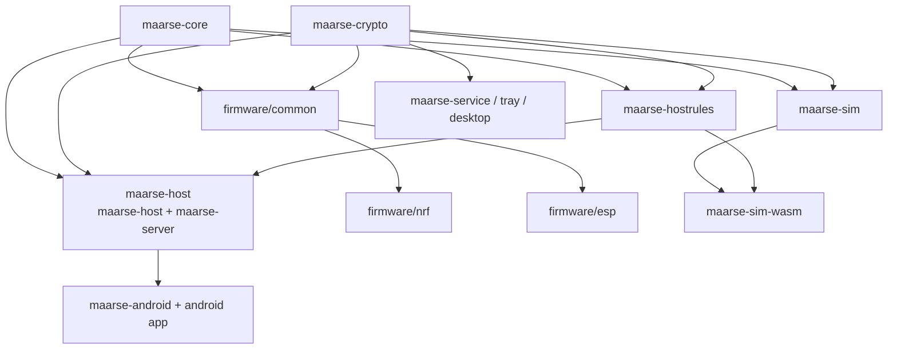

# Component map

> **Type:** explanation · **Status:** working copy (checked against the `Cargo.toml` files and crate docs on 2026-11-27)

Every directory of the repository, what it is responsible for, and what it
depends on. For how the parts fit together at run time, see the
[architecture overview](overview.md).

## Shared Rust crates (`no_std` where noted)

| Crate | Responsibility | Depends on |
| --- | --- | --- |
| `maarse-core` | Protocol core, `no_std`, no heap, so it runs on the microcontrollers: addresses, packet format, duplicate filter, route table, airtime budget, the `Router`, send priorities (`qos`), announce stamps (`stamp`), companion protocol codec (`companion`). | none |
| `maarse-crypto` | Identities (Ed25519 + X25519), signed announces, the static seal, the forward-secrecy ratchet, channel keys, signed bulletins, firmware signing, recovery phrase. | none |
| `maarse-hostrules` | The host's pure rules (no I/O, no clock): shared by the real host and the simulator so both run the same decisions. | core, crypto |
| `maarse-voice` | Voice messages with Codec2. | none |
| `maarse-uf2` | ELF to UF2 conversion and `maarse-sign` (signed firmware and releases). | crypto |

## Host side (PC, server, phone)

| Crate / directory | Responsibility | Depends on |
| --- | --- | --- |
| `maarse-host` | The host: gateway between LoRa radios, TCP backbone and clients, plus its own node. Library (also embedded in the Android app) and two programs: `maarse-host` (desktop) and `maarse-server` (dedicated server with an admin dashboard). Owns web server, WebSocket, history, post office, DHT, MeshCore access, page server, MQTT, firmware updates. | core, crypto, hostrules |
| `maarse-client` | The web client (static HTML/JS, also a PWA) and `flash.html`, the browser flasher. Served by the host. | (served by host) |
| `maarse-service`, `maarse-tray`, `maarse-desktop` | Windows service with signed updates, tray app, the installed desktop app (`maarse.exe`). | crypto (service) |
| `maarse-android` | JNI bridge that runs `maarse-host` inside the Android app. | host, voice |
| `android/` | The native Android app (Kotlin, Jetpack Compose). Talks to the embedded host over the companion protocol on loopback. | (via JNI) |

## Firmware (`firmware/`, excluded from the main workspace)

| Directory | Responsibility | Depends on |
| --- | --- | --- |
| `firmware/common` | Shared firmware logic (`maarse-fw-common`): node, bus, storage, OTA. | core, crypto |
| `firmware/nrf` | nRF52840 + SX1262: WisMesh Tag, XIAO nRF52840. Bluetooth, USB serial, UF2 bootloader. | common |
| `firmware/esp` | ESP32-S3 + SX1262: Heltec V4, XIAO ESP32-S3. Bluetooth, Wi-Fi, display, USB. | common |
| `firmware/meshcore-gateway` | MeshCore gateway firmware (PlatformIO, separate from the Rust firmware). | none |
| `firmware/vendor/lora-phy` | Vendored radio driver. | none |
| `firmware/vendor/trouble-host` | Vendored Bluetooth host library (nRF52840 only): version 0.8.0 with one patch that keeps its 4 KB packet pool out of flash. | none |

## Simulation, testing, measurement

| Crate / directory | Responsibility |
| --- | --- |
| `maarse-sim` | Command-line simulator running the real `Router` in many virtual nodes. |
| `maarse-sim-wasm` | The same engine compiled to WebAssembly for the [Denmark simulator](../denmark/README.md). |
| `maarse-fuzz` | Small dependency-free fuzz engine (deterministic, reproducible by seed). |
| `maarse-lab`, `maarse-lab-data` | Test lab in the browser: runs suites, fuzzing, simulator scenarios and benchmarks; stores history. |
| `tools/` | End-to-end and hardware tests (Python and Node), release tooling, asset generators, simulator experiments. |

## Data, packaging, scripts

| Directory | Contents |
| --- | --- |
| `sensors/` | Sensor catalog, board descriptions and templates ([sensors.md](../sensors.md)). |
| `i18n/` | Translation files (English and Danish) ([i18n.md](../i18n.md)). |
| `packaging/` | systemd unit and Windows installer files. |
| `scripts/` | Build, flash and install scripts (`build-firmware`, `install-server.sh`, `start-host`). |
| `docs/` | This documentation, the simulators' web pages, mockups and analyses. |

## Dependency picture

*Figure: crate dependencies, taken from the `[dependencies]` sections of the
`Cargo.toml` files. The firmware and the host share `maarse-core` and
`maarse-crypto`, which is why the simulator can run the same router code as the radios.*
