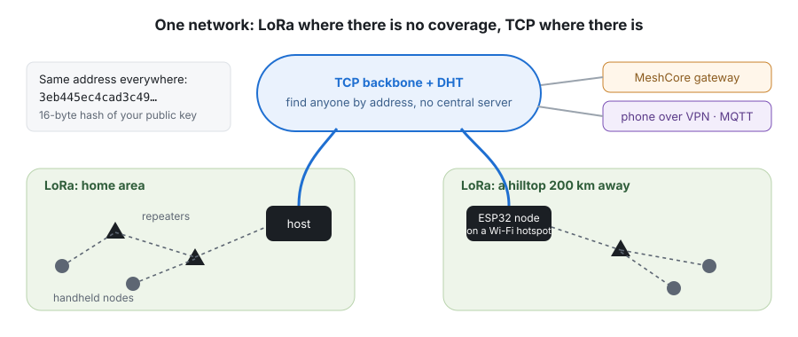
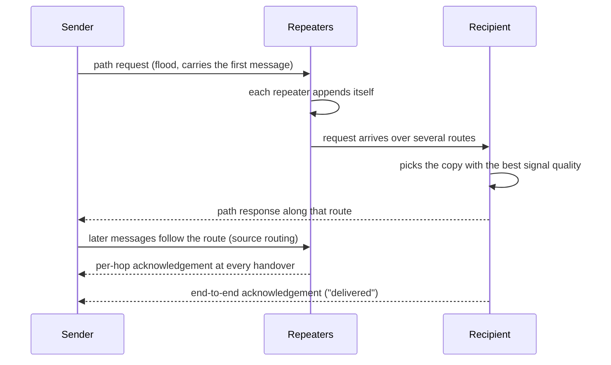

# Architecture overview

> **Type:** explanation · **Status:** working copy · Reader: someone new to the project who wants the whole picture before reading the [protocol specification](../protocol-spec.md).

Må:rse is a mesh network for LoRa radios with an optional internet backbone.
Every participant has one 16-byte address, a hash of its public key, that is
the same over LoRa, TCP and the internet. This page explains the parts and how
a message travels through them. Details live in the pages it links to.

## The big picture



*Figure: radio areas (handheld nodes, repeaters, a host) are joined by a TCP
backbone where internet exists. A DHT lets any host find the gateway for an
address it has never heard over radio.*

Three kinds of thing take part:

| Part | What it is | Where it runs |
| --- | --- | --- |
| **Node** | An identity that sends, receives and (depending on role) forwards packets. | Firmware on a LoRa board; the host program; the phone app (which embeds the host) |
| **Host** | A program that is a node itself *and* a gateway: it attaches radios (USB, Bluetooth, Wi-Fi modem, KISS), joins TCP/UDP links, keeps history and a post office, and serves the web client. | PC, server, phone |
| **Client** | The user interface: web client or Android app. It talks to a host or a single radio with the **companion protocol**. | Browser, phone |

The full list of crates is in the [component map](component-map.md).

## Layers

```text
 UI              web client · Android app · Heltec display
 ─────────────── companion protocol (USB serial, Bluetooth, WebSocket) ───────────
 Application     direct messages · channels · files · voice · pages · alerts · sensors
 Security        identity · static seal · ratchet · channel keys · signed bulletins
 Routing         path discovery · source routing · per-hop ack · carry · post offices
 Link            LoRa (SX1262) · TCP backbone · UDP · serial · KISS · Wi-Fi modem
```

| Layer | Source | Reference | Explanation |
| --- | --- | --- | --- |
| Link and packet | `maarse-core/src/packet.rs` | [spec section 3](../protocol-spec.md#3-packet-format) | [Routing](../concepts/routing.md) |
| Routing | `maarse-core/src/router.rs`, `qos.rs` | [spec section 5](../protocol-spec.md#5-routing) | [Routing](../concepts/routing.md) |
| Security | `maarse-crypto/src/*` | [spec section 6](../protocol-spec.md#6-cryptography) | [Identity and keys](../concepts/identity-and-keys.md), [threat model](../security/threat-model.md) |
| Mailboxes, backbone | `maarse-host/src/node.rs`, `dht.rs` | [spec section 8](../protocol-spec.md#8-mailboxes-and-the-backbone) | [Post offices and carry](../concepts/post-offices-and-carry.md) |
| Companion protocol | `maarse-core/src/companion.rs` | [spec section 9](../protocol-spec.md#9-companion-protocol) | |

## How a message travels



*Figure: route discovery and delivery. Only a small path request is flooded;
afterwards only repeaters on the chosen route transmit. A lost packet is
resent on the hop where it was lost, not from the sender.*

If the recipient is offline, a post office holds the message until the
recipient comes back; if it is out of reach of any repeater, a relay can carry
it. See [Post offices and carry](../concepts/post-offices-and-carry.md).

## Roles

| Role | Forwards for others | Typical device |
| --- | --- | --- |
| Client | no | phone, handheld |
| Repeater | yes | rooftop or hilltop board |
| Relay | yes, and carries messages it cannot deliver (forest mode, at most 4 hops) | handheld in the field |
| Anchor | yes, and splits long routes so a route may be 12 hops on each side of the backbone | host or server always on the internet |
| Auto | switches between client and relay by coverage | handheld |

Source: `Role` in `maarse-core/src/router.rs`; behavior in [spec section 5.1](../protocol-spec.md#51-roles-and-forwarding-permission).

## Design constraints that shape everything

- **One radio setting for the whole network.** Every node and long-distance
  link uses the same frequency, spreading factor and settings, so any device can
  talk to any other. Links are improved with antennas and smarter software only.
  See [decision 0003](../decisions/0003-one-radio-setting.md).
- **No heap on the radios.** `maarse-core` is `no_std` without allocation, and
  the ESP32 firmware has under 100 bytes of stack to spare with a host attached.
  Anything added to the core must pass a stack check
  (`tools/stack_probe.py`).
- **Airtime is the budget.** A short direct message is mostly overhead
  (64-byte seal plus header), so formats are chosen to save airtime.
- **Same code in the radio, the host and the simulator.** `maarse-hostrules` has
  no I/O so the Denmark simulator runs the host's real decisions.

## Where to go next

- Learn by doing: [Tutorial: your first node](../tutorials/first-node.md)
- Understand a mechanism: [Concepts](../concepts/README.md)
- Check a format or constant: [protocol-spec.md](../protocol-spec.md)
- Know what is proven and what is not: [Verification](../verification/README.md)
