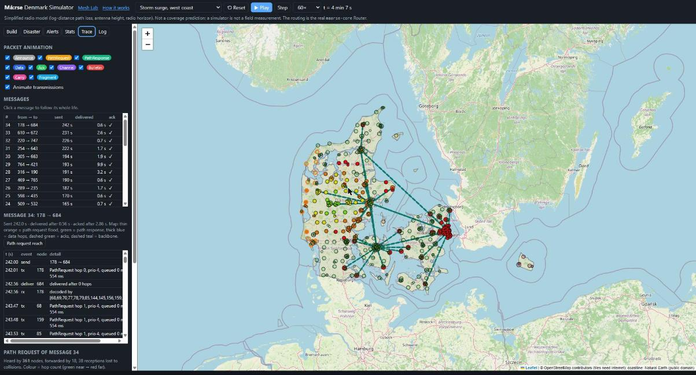

# Må:rse Denmark Simulator

Build and break a national Må:rse network in the browser. Every node runs the
**real `maarse_core::Router`** (the same code as the firmware), compiled to
WebAssembly. Only the radio, power and backbone around the routers are simulated.

> Simplified radio model. It is not a coverage prediction, and a simulator is not
> a field measurement.




## Build and open

```sh
rustup target add wasm32-unknown-unknown      # once
python tools/build_denmark_sim.py             # -> docs/denmark/maarse_sim_wasm.wasm
python -m http.server -d docs 8000            # browsers do not load .wasm from file://
# open http://localhost:8000/denmark/          (presets: #normal #internet_loss #bornholm #storm #e45 #forest #festival #spam)
node tools/denmark_sim_test.mjs               # headless test (needs the built .wasm)
cargo test -p maarse-sim-wasm                 # the engine's native tests
```

Map tiles come from OpenStreetMap (internet needed). The Denmark coastline is
embedded (`dk-land.js`), so land/sea, islands and node generation work offline.

## Using it (v3, 2026-11-19)

* **Modes** at the top: **Build** (generate a network per region, place
  devices and people, terrain, performance, save), **Send** (send and follow a
  message, alerts), **Break** (cut links, internet, power, storms, switch every
  node's radio), **Results** (statistics, delivery time, busiest nodes, why
  messages were not delivered, compare runs, packet log), **Phones** (two
  phones on simulated nodes). Light and dark mode with the button top right.
* **Everything on the map is clickable**: hover says what a click does;
  right-click a node for send from/to, announce, stop, reboot, cut internet,
  track, delete; right-click a link to cut or restore it.
* **Follow a message**: Send > Send and follow. A panel on the map says where
  it is now (searching, queued, on air, on the backbone, waiting in a post
  office, carried, held, delivered, no progress) and a pulsing dot shows the
  place. Break something meanwhile and watch the status change.
* **Track a node** (right-click > Track): a line coloured by its best contact
  and a watch list with contact, battery and its messages.
* **Generate**: users per region and how they connect (LoRa only, LoRa +
  internet, app only), cars and relay boxes.
* **People**: Build > + Person: click A, waypoints and B; set what they carry,
  speed, start time, pauses and what happens at the end.
* **Save**: runs and snapshots stay in this browser; open a snapshot or start
  a branch from it; Copy link puts the run in the URL.
* **Normal day**: Build > Traffic, start time of day: the rates follow a day
  curve.
* **Presets with expected results** (Great Belt cut, Bornholm on its own,
  power cut in Nordjylland) are checked by `node tools/denmark_sim_test.mjs`.

### Traffic on the map

The working copy adds **Traffic** to the play bar and **Layers** menu of the
browser simulator. Run a scenario with packet tracing enabled (the default).
In live view, a colored point traces a recorded hop from sender to receiver.
Three rings expand at the receiver while the trail fades. Solid trails show
LoRa, including dedicated trunks, and dashed teal trails show TCP or Wi-Fi.
Live path requests show selected radio legs where the trace records reception
and subsequent forwarding. Pin a broadcast to inspect its individual
receptions. Routine announces and hellos stay in the feed. The live map limits
the number of concurrent trails and pulses, uses static marks if the browser
requests reduced motion, and skips animations above 200×. Traffic collection
continues at all speeds.

* Filter the packet list by type, routed traffic or the message you are
  following. Select a row to pin its packet ID and quiet the other traffic on
  the map. Numbered hops show the order of recorded directed receptions.
  Faint lines show radio receptions without a specified next hop, red rings mark missed hops or drops,
  and purple rings mark repeated attempts by the same sender to the same
  next hop. The card shows the selected transmission and its recorded reception
  details. **Replay packet** redraws its retained observations in time order
  without changing the simulation clock. **Follow message** opens the existing message journey, including
  routing, delivery, and acknowledgement where recorded.
* Click the traffic histogram, drag the history slider, or use **Scenario
  events** to jump to a simulated time. The map shows up to the previous ten
  simulated seconds of traffic at the cursor. A pinned packet shows its
  retained trace through the cursor. The simulator clock and network state
  continue independently. **Live** returns to the latest traffic.
* Traffic history holds up to 12,000 recent feed entries in memory. The
  bounds are shown beside the slider, and the oldest time advances as entries
  expire. Resetting or loading a scenario starts a new history. Opening a
  saved snapshot reconstructs history as its scenario replays. The map caps
  visible marks in busy runs and uses sampled positions for moving nodes.

For a repeatable example, choose **Great Belt traffic demo**
(`#great_belt_traffic`) with terrain disabled. The first Nyborg → Korsoer
message crosses by TCP. TCP goes down at 19 s. A 100 dB radio-loss event
starts at 20.2 s, while the second message is on air. Jump to that event,
move the cursor past 20.6 s, and select the second message's Data row to see
the missed hop. **Follow message** shows its later delivery after the radio
recovers. The third message crosses over LoRa while TCP stays down. These
are simulation results from the preset and its fixed seed.

### Live real-world traffic

The working copy adds observed traffic to **Real world** in the browser
simulator. Build or install matching `maarse-host` or `maarse-server` binaries
with this feature. In the dedicated server dashboard, open **Settings**,
enable **Share the public map** and **Share live traffic**, then choose **Save
and restart**. The host needs
an HTTP listener reachable by the browser. Use HTTPS for hosts accessed from
the HTTPS simulator page, typically through the existing reverse proxy.
Enable position sharing for the host if you want a marker on the map.

Open **Real world** (G), enter the host's HTTP(S) URL and press **Show**.
**Live observed traffic** is selected by default. It opens a dark map view
with the reporting hosts and a compact activity list. Orange denotes radio,
green denotes a dedicated trunk and blue denotes backbone. Solid rings show
receives and dashed rings show sends at the reporting host's shared position.
Use the transport buttons to filter live rings and history. Select a row and
choose **Replay pulse** to view that one-second observation again. The local
slider and activity strip cover up to 60 seconds collected in the current view. **Live**
returns to the latest observations. **Simulation** restores the simulator
layers and controls. The simulation can continue in the background.

**Host totals** shows ten seconds of counts per host and transport, including
hosts without a shared position. The browser polls about once a second using
complete one-second buckets. The pulses show local observations and an outgoing
count means the host queued a frame on a link. The view has no peer coordinates
or confirmed end-to-end route.

**Share the public map** alone serves the static map. The separate opt-in
**Share live traffic** makes `/api/public/traffic` readable by anyone who can
reach the endpoint. This aggregate feed contains counts, link categories and
activity timing. On the updated host, the setting also enables recent
verified announce observations in the network feed below. The browser
trusts the configured server to report its measurements. Reception on a real
radio requires a connected radio or modem.

### Network overview and the view switch

The switch at the top right of the map chooses what is shown:
**Simulation** (the simulated network only, the default), **Real network**
(the simulation is hidden and the real nodes of the public servers are drawn
in its place) or **Both**. **Real network** opens the network overview, which
can also be opened with `?view=network`. It shows the real network at a
glance from the same public feeds, in the style of a mesh telemetry site:

- Figures along the top: nodes on the map, nodes heard in the last hour,
  packets per minute, received and sent packets in the last 10 seconds per
  transport (radio, trunk, backbone), servers reporting, observers heard and
  open-channel messages.
- A searchable **node list** with role filters. Select a node to see its
  card (role, last heard, position, antenna height, gain, power, owner and
  its latest announces) and a halo on the map.
- **Live packets** (every packet group of the last two minutes with type,
  transport, hops, SNR and how many observers saw it), **Channels** (open
  channel messages with the sender's name) and **Types** (a 2-minute
  activity graph and the packet types since the overview opened).
- **Sound** gives a short tone for a new public message, another open
  channel, a direct message seen passing and a new node. The choices are
  saved in the browser only. The browser plays sound after the first click
  on the page.

The overview reads the hosts saved under **Real world**, or
`https://nj01.dk.eu.maarse.dk` when none are saved. It only shows what a
server has chosen to share: nodes with a shared position, packet metadata and
open channels. Direct messages are encrypted and never shown.

### Packet observers and public channels

With the updated server and website, **Packets** in **Real world** shows
verified announces heard by the collector, open-channel activity, and any
approved observer reports. **Public channels** shows new messages. Both
read `/api/public/network`.

1. Build or install the updated `maarse-server`. In **Settings**, turn
   on **Share the public map**, **Share live traffic** and **Share open
   channels**, then choose **Save and restart**. Channel publication
   requires this one server-wide opt-in and uses the channel's existing
   public or private setting. Earlier `--public-channel` entries still work.
2. For a TCP-only Android node, use **Phone node** mode for the phone's
   own identity. In **Name and position**, turn on **Share my position**,
   allow location, and choose the precision. A PC host can set a position in
   **Sharing in announces**. The collector shows the position from the
   signed announce at the chosen precision and clears the pin when it
   receives an announce without a position. Phones acting as remote
   companions use the remote node's identity. Firmware nodes marked mobile
   remain excluded from the public map.
3. On the website, select **Real world**, enter the collector's HTTP(S) URL,
   and choose **Show**. Select **Packets** or **Public channels**. A packet
   row groups observations. Select the row to see which hosts reported it
   and measured SNR where available. When an announce's node is on the map,
   its pulse uses that node's shared position. Other packet pulses use the
   reporting host's shared position.

Observer registration is optional for directly received traffic. To collect
observations from additional hosts with radios or other links, install the
updated host on those machines too:

- Add each reporter's 128-hex public identity under **Allowed observers**. This is the public key printed at startup,
  also labelled **Bulletin key**.
- On each reporter, set **Observation collector** to
  `host:port@collector-public-identity`. Use exactly
   the endpoint of an existing outgoing TCP peer. The host reports to that
   one collector when it advertises support. The direct peer link works from
   behind NAT. Reports are authenticated and encrypted with existing
   Må:rse identities and use a bounded, low-priority queue.

The Denmark simulator URL also accepts `?view=channels` and `?view=packets`
as direct links into these views. When no hosts are saved in the visitor's
browser, the site uses `https://nj01.dk.eu.maarse.dk` as the collector.

The collector observes the traffic that passes through its own links as well
as authorized reports. TCP reports never contain message text or raw packets.
The packet view has up to 100 recent groups from the last two minutes and up
to 32 displayed observations per group. **UTC today** counts LoRa and trunk
receptions, reporting identities, and distinct radio packet IDs. The unique
counter displays a lower bound after 500,000 IDs in a day. Counts and history
are in memory and reset on restart. Plan a continuous pilot day for volume
comparisons.

The public channel feed stores up to 200 new messages for up to 24 hours in
memory. It reads eligible traffic received by the collector or queued for
transmission there. The built-in `public` key is always known. The host
inside the updated Android **Phone node** app and updated PC hosts send
other open names alongside messages over compatible TCP links. These
names follow the messages through compatible intermediate hosts. A legacy
host or a radio-only path can carry the packet without the name. If the
collector has not learned or joined that channel, add its name and region
under **Additional known open channels** (`--public-channel '#maarse@dk'`)
or update the hosts between the sender and collector. Unnamed regions of
`public` use their numeric wire ID.

The collector checks the packet's address and region and decrypts using only
the matching deterministic open key. Invitation-key channels, direct text,
and signed `#bulletin` content are excluded from channel publication.
Anyone who can reach the endpoint can read its open text, observations and
timing. The open key can be derived from the channel name, and the displayed
sender is the writer's claim. Observed traffic covers the packets the
collector receives and the metadata reported by configured observers.
Public packet IDs are opaque and change when the server restarts. An
authorized reporting host can still send false observations. The TCP observer
link requires current clocks and represents host-side observations, including
queued sends. Physical radio coverage and multi-backbone report relaying are
separate from this direct-to-collector pilot.
The loopback regression test is `python tools/observer_test.py` after building
the host binaries. It exercises emulated modem streams, open and private
channel traffic over two TCP links, and a TCP node's shared position and
announce. It uses the same companion protocol as Android, with test
coordinates supplied over WebSocket. Physical GPS, radio and the deployed
collector require separate verification.

## Design

### Layers

```
docs/denmark/app.js        map editor, controls, views (Leaflet 1.9.4)
docs/denmark/scenarios.js  Denmark generator + presets  -> scenario JSON
docs/denmark/maarse-sim.js JSON in / JSON out wrapper for the .wasm
maarse-sim-wasm            engine: radio, queues, power, backbone, timeline, trace
  maarse_sim::radio        path loss and SNR limits, shared with the maarse-sim CLI
  maarse_core::Router      unchanged, one per node
  maarse_crypto::bulletin  real signed bulletins for area alerts
```

### Why a new engine module instead of moving the CLI engine

The CLI engine (`maarse-sim/src/main.rs`) is built around a dense N×N gain
matrix and scenario flags (forest, hill, highway, bridge variants) woven through
it. Moving it unchanged into a library would not give a national map (N² links
for 2,000 nodes, no coordinates, no per-node height/SF/battery), and reshaping
it risks changing the CLI's numbers, which must stay identical. So:

* the **radio model** moved to `maarse-sim/src/radio.rs` (library) and both use
  it; the CLI's output is byte-identical for the same seed and flags;
* the Denmark engine (`maarse-sim-wasm/src/engine.rs`) is a new event loop that
  copies the CLI's **rules** one to one: CAD with 100–600 ms backoff and 8 tries,
  `DutyCycle` with a 120 s give-up, the collision rule (an overlapping signal that
  is decodable at SNR − 6 dB and less than 6 dB weaker kills the packet),
  half-duplex, slot jitter, `note_airtime` for load control, and the neighbour
  seeding the CLI does instead of real neighbour announces.

What it adds: sparse links via a spatial grid (only pairs within radio horizon
and interference range are stored), a send queue per node ordered by
`qos::priority_with(packet, #bulletin)` (the firmware has a queue; the CLI does
not model one), per-node SF, antenna height, batteries, power cuts, backbone
links and timeline events.

### No wasm-bindgen

The module exports five C functions (`buf_alloc`, `out_ptr`, `out_len`,
`sim_create`, `sim_call`, `sim_free`) and passes JSON through one buffer.
That needs no generated glue and no `wasm-bindgen-cli` whose version must match
the crate, works the same in Node and the browser, and costs little because
calls are coarse (one `step` per frame). `getrandom` gets a failing custom
backend: the engine always seeds its RNG from the scenario.

### Radio model (crude, honest)

* Path loss: `maarse_sim::radio` (log-distance, n = 3, 868 MHz), thermal noise
  + 6 dB, SNR limit per SF. Same numbers as the CLI.
* Antenna gain: 6 dB for fixed stations (repeater, anchor, host, Wi-Fi node),
  like the CLI's `--repeater-gain`.
* Height gain: +10 dB per decade above 1.5 m (handheld 1.5 m, relay 2 m,
  repeater 15 m, host 10 m, Wi-Fi node 6 m, mast/anchor 40 m; editable).
* Radio horizon: no link beyond `4.12 km × (√h1 + √h2)`.
* Nodes on different SFs do not hear each other.
* Clutter (forest, town): a scenario can have `clutter` polygons with a loss
  in dB/km, a canopy height `canopy_m` (default 15 m; the town preset uses
  12 m for roofs) and a saturation `max_db` (default 29 dB). The default
  `canopy` model (since 2026-11-16) counts only the part of a link's straight
  line that runs inside the polygon *below the canopy* (sampled every 250 m),
  so an antenna on a hill or a mast sees over the trees, and each half of the
  link saturates on its own after ITU-R P.833 vegetation loss:
  `A = Am (1 - exp(-γ d / Am))` per end, γ = `db_per_km`, Am = `max_db`
  (0.18 f^0.752 ≈ 29 dB at 868 MHz). Beyond that depth the signal goes over
  the canopy instead of through it. `"clutter_model": "linear"` gives the
  first model (every km inside costs `db_per_km`, heights ignored), which the
  older tables below were measured with; under it a person on a hill inside
  the forest could never reach out, so edge bridges could not be tested.
* Radio loss in an area (`degrade` event: storm, rain, jamming): every link
  with an end inside loses `db` dB until `degrade_clear`.
* No terrain, no buildings, no land/sea difference in loss, no fading.

### Power

Mains nodes (repeater, anchor, host, Wi-Fi) fall back to their battery in a
power cut; nodes without a battery die. Battery nodes drain their idle power
(handheld 0.05 W, repeater 0.4 W, host 6 W) and the router's `energy` follows
the charge (Full > 60 %, Ok > 30 %, Low > 10 %, else Critical), so energy-aware
flood delays in the router apply. A host in a power cut loses its internet.

### Backbone

Like maarse-host: a host sends every packet it transmits to all its working
links too (TCP 40 ms, Wi-Fi point-to-point 5 ms), and the peer's router receives
it with SNR 10 dB. Floods with a region go only to peers that serve the region.
A TCP link works only while both ends have power and internet (global, per
region, per node); a Wi-Fi link needs only both ends alive.

Because every host sends path requests to every TCP peer and then floods them
into its own area, one direct message to a new destination wakes up the whole
country: Skagen to Copenhagen in the generated net is about 90 path request
transmissions in all five regions and 60+ backbone copies. That is how
maarse-host behaves today with permanently connected peers.

`dht_backbone` (experimental, off) models the alternative the project README
describes: a host does not send path requests to its TCP peers, but looks up
the destination's gateway (the nearest host with internet in the destination's
radio island) and sends it there directly (a dynamic link, like `dht_connect`);
routed packets then use that link too. Measured on the national preset (15 min,
seed 1): 27 % less airtime and 35 % fewer lost receptions, but 96.5 % instead
of 98.6 % delivered. It is a model of the idea, not of maarse-host's code.

### Home routing (a model, not a protocol yet)

Repeaters, masts, hosts and backbone links do not move; only the last hop
(a person's handheld to the nearest fixed node) changes. `home_routing`
models a routing that uses this, built from parts the router already has:

* **Fixed nodes**: repeaters, masts, hosts and Wi-Fi nodes that do not move.
  Links between them with an SNR 5 dB over the limit are infrastructure; the
  fixed nodes know the shortest routes between them (as a proactive routing
  among fixed nodes would; it is static, so updates would be rare).
* **Home**: every node's home is the fixed node it hears best (recomputed
  every 60 s, so moving nodes have a stale home for up to a minute).
* **Lookup**: a sender without a route asks where the destination is. Its own
  home answers if the destination is within the announce scope (8 hops:
  every fixed node hears those announces anyway, so this registry costs no
  airtime); otherwise the gateway of its island does (the DHT knows every
  node's gateway). The question and the answer are real datagrams over the
  radio, asked again every 4 s, at most 3 times.
* **Route**: the answer is a source path along the infrastructure: all the
  way by radio, or up to the sender's gateway, over the backbone, and down
  from the destination's gateway, whichever has fewer radio hops. Longer than
  12 repeaters: hosts are anchors in this model, so the route is split at the
  sender's gateway, which gets its own route for the rest (the router's anchor
  mechanism, unchanged).
* The message then goes through the real routers along that path (per-hop
  acks, local repair, and the router's own fallback to a path request when the
  route fails). Without an answer the sender falls back to a path request; a
  destination known to be unreachable (another island without a working
  gateway) is not flooded at all.

Not modelled: the airtime of keeping the infrastructure routes and the
registry up to date (announces are not simulated in any mode), and a registry
on fixed nodes in places without a gateway (the forest: lookups fall back).

Results (`node tools/sim-experiments/home_routing.mjs 600 1,2,3`: national
preset, 10 min, mean of seeds 1-3; random destinations, so every message
needs a new route, the worst case for floods):

| msgs/min | | today | DHT backbone | home | home + DHT |
|---|---|---|---|---|---|
| 6 | delivered / acked | 97.9 / 97.9 % | 94.2 / 94.2 % | 99.5 / 98.9 % | 99.5 / 98.9 % |
| | airtime | 3,797 s | 2,235 s | 439 s | 439 s |
| | latency p90 | 8.2 s | 20.1 s | 4.1 s | 4.1 s |
| 30 | delivered / acked | 82.8 / 67.3 % | 94.0 / 90.1 % | 92.8 / 88.7 % | 97.3 / 96.9 % |
| | airtime | 13,948 s | 7,633 s | 4,429 s | 1,480 s |
| | latency p90 | 54.5 s | 47.9 s | 19.9 s | 8.1 s |
| 90 | delivered / acked | 54.1 / 34.9 % | 81.9 / 69.3 % | 64.8 / 50.1 % | 77.3 / 61.4 % |
| | airtime | 17,199 s | 10,898 s | 13,387 s | 10,442 s |

Single messages (`tools/sim-experiments/home_edge_cases.mjs`, seed 1, quiet
network): Skagen to Copenhagen 18 transmissions and 5.3 s instead of 149 and
13.6 s; Skagen to Rønne while Rønne's host has no internet: 6 transmissions
(the lookup) instead of 254. The E45 car (a moving destination): one seed
worse (90 % instead of 99 % delivered, twice the airtime), one better (100 %
instead of 92 %), one the same. The forest has no gateway, so it behaves as
today.

What the numbers say: at ordinary load, routing over the fixed infrastructure
removes almost all floods. Under overload (90/min) lookups are lost in the
remaining floods and fall back, and traffic concentrates on the infrastructure
links (more losses at the next hop), so the DHT backbone alone does best there.

### Reboots and known contacts

A node's app can read a direct message only if it knows the sender's keys
(from an announce). The router acknowledges a message as soon as it arrives,
so a node that forgot its contacts sends "delivered" for a message the user
never sees. Found on the bench on 2026-11-15 (an ESP32 forgot its contacts on
every reboot) and fixed in the firmware: contacts are kept in flash, and a
message from an unknown sender is kept until the sender's announce arrives.

The simulator models it: at the start every node knows everyone; a `reboot`
event (also revive and power back, since the node was off) clears RAM (routes,
neighbours, queue, kept messages) and, unless `persist_known`, the contacts;
afterwards the node knows only those whose announce it has heard. A message
counts as *shown* when the recipient knows the sender; with `hold_unknown` it
waits for the sender's announce, without it it is dropped. A sender that lost
the recipient's keys cannot send at all. `announce_s` makes every node announce
periodically, at a random moment per node and then every interval ±10 %
(the firmware does every 15 min); a rebooted node announces after 5 s.

Results (`node tools/sim-experiments/reboot.mjs 1200 1,2,3`, preset `reboot`:
national day, announces every 12 h, 40 % of the handhelds reboot at 3 min):
mean of 3 seeds, 20 min, about 190 direct messages.

| | delivered | shown | acked, not shown | dropped | kept, then shown | not sent |
|---|---|---|---|---|---|---|
| before the fix | 68.2 % | 49.4 % | 35.3 | 36.0 | 0 | 51.7 |
| keep unknown senders only | 68.2 % | 49.9 % | 34.3 (waiting) | 0 | 1.0 | 51.7 |
| contacts in flash only | 93.1 % | 93.1 % | 0 | 0 | 0 | 0 |
| both (firmware now) | 93.1 % | 93.1 % | 0 | 0 | 0 | 0 |

Before the fix, about one message in four could not even be sent (the sender
had lost the recipient's keys), and of the delivered ones more than one in four
was never shown, while the sender saw "delivered". Keeping messages from
unknown senders alone hardly helps with 12 h between announces: they wait for
an announce hours away. Contacts in flash remove the problem; keeping unknown
senders' messages then matters only for contacts never heard before. (With
announces every 15 min the picture is the same, at lower delivery: 48 % shown
before the fix, 69 % with it.)

The periodic announces themselves are expensive at national scale (same
preset without reboots, seed 1, 20 min):

| announce interval | delivered | announce transmissions |
|---|---|---|
| none | 99.0 % | 0 |
| 12 h (random moment per node) | 98.0 % | 2,117 |
| 1 h | 92.1 % | 14,237 |
| 15 min (the firmware's default) | 79.0 % | 29,372 |

At 15 minutes announces take more airtime than all path requests together.
With contacts kept in flash a long interval loses little (a rebooted node
still announces after 5 s), so the preset uses 12 h.

### Automatic forest mode and the relay hop limit

`auto_relay` lets handhelds switch role by themselves: a handheld that has not
heard a repeater or anchor for `auto_relay_after_s` (default 600 s) becomes a
relay (forwards floods up to `relay_hops`, default 4, now at most 12); after
2 minutes of hearing one again it is a client again. Not in the firmware yet.

Results (`node tools/sim-experiments/forest_mode.mjs both 2700 1,2,3`, mean of
3 seeds, 45 min; forest = 10 walkers in Rold Skov, town = 300 handhelds in
Aarhus with town clutter and repeaters in the western half only):

| | forest delivered | town delivered / acked | town airtime |
|---|---|---|---|
| all clients | 49.4 % | 81.1 / 79.9 % | 1,934 s |
| all relays, 4 hops | 82.1 % | 80.4 / 37.4 % | 20,565 s |
| all relays, 12 hops | 83.6 % | 57.8 / 17.0 % | 23,344 s |
| auto after 10 min, 4 hops | 72.5 % | 91.4 / 88.3 % | 4,211 s |
| auto after 10 min, 12 hops | 74.7 % | 91.1 / 88.6 % | 4,252 s |
| auto after 2 min, 4 hops | 79.2 % | 93.6 / 90.3 % | 4,614 s |
| auto after 2 min, 12 hops | 79.5 % | 93.1 / 89.0 % | 5,090 s |

What it says: making every handheld a relay rescues the forest but swamps a
town (ten times the airtime, most acks lost). Automatic forest mode gets most
of the forest gain and is the best variant in the town, because only the
handhelds without a repeater (52 of 300) become relays. Switching after 2
minutes beats 10 (the walkers relay sooner). 12 hops instead of 4 adds about
one point in the forest and nothing in the town, and with many relays it does
harm, so 4 stays the default.

### Edge bridges (automatic forest mode, part 2)

An edge bridge is a node that hears a repeater while a neighbor does not: the
group's way into the repeater network (the person on the hill). Plain
automatic forest mode turned such a handheld into a client after 2 minutes
with the repeater, so the group lost its bridge. Measured with the canopy
model (`node tools/sim-experiments/edge_auto.mjs both 2700 1,2,3,4,5,6,7,8`,
mean of 8 seeds, 45 min, announces every 12 h; forest = 10 walkers in Rold
Skov and one handheld on a 25 m hill, the only one who reaches the repeater
12 km away; town = 300 handhelds in Aarhus, repeaters in the western half):

| | forest delivered | forest into/out of the forest | town delivered / acked | town into/out of the uncovered part | town airtime |
|---|---|---|---|---|---|
| all clients | 46 % | 44 % | 88 / 87 % | 45 % | 1,851 s |
| all relays | 100 % | 100 % | 74 / 27 % | 90 % | 19,597 s |
| A auto, no bridges | 77 % | 49 % | 91 / 88 % | 78 % | 2,772 s |
| B auto, bridge per stretch | 96 % | 90 % | 92 / 85 % | 93 % | 5,431 s |
| **Q auto, named bridges + boundary** | **97 %** | **96 %** | **93 / 89 %** | **94 %** | **3,653 s** |

(B with 5 seeds.) Q is in the firmware. It borrows from three systems:

- **OLSR multipoint relays** (`auto_bridge: "named"`): a node without
  coverage chooses one bridge, the nearest one it has heard announcing
  (within the 4 relay hops, lowest ID among equally near ones), and names it
  in its announce (role field bytes 2-3). A bridge stays while a neighbor
  names it, and a covered node steps in only for a neighbor without coverage
  that has no bridge yet. Bridges announce every 10 minutes so the group can
  choose; a node that has a bridge counts as found by the network (12 h
  announces instead of every 15 minutes), and announces soon after its
  choice changes.
- **Reticulum boundary interfaces** (`bridge_boundary`): a bridge forwards a
  path request from a covered neighbor not at all, and one from a repeater
  only when the destination is known to be without coverage (from the role
  flags of its announces). Most of a town's path requests stay out of the
  uncovered part.
- **Thread router-eligible end devices and Trickle** (`bridge_p: -0.25`): a
  client steps in only after 2 minutes of steady coverage (after a mass
  restart every neighbor first looks uncovered: all 300 town nodes became
  relays at once), with chance max(1 / (1 + neighbors that hear a repeater
  too), 1/4) per 15 s check. The person on a hill has no rivals and takes
  the job at once; nodes along a town's coverage edge leave room for the
  first one.

What did not work: one bridge per stretch with the lowest ID winning (B)
made 12-14 bridges along the town's edge and doubled its airtime; OLSR-style
bridge counts without names oscillated (366 role switches); load control
cost 10-15 points; a longer bridge hold time (10 or 30 min) meant more
bridges at once and more airtime; a density limit for forest mode (only
where fewer than 4 forwarders are heard) changed nothing, because every node
starts with zero.

The new summary keys are `cross_msgs` and `cross_delivered_pct` (messages
where exactly one end heard a repeater when sent), and `state` reports each
node's role (`c`, `r`, `b` bridge, `R`, `A`).

### Smaller and fewer packets (2026-11-16)

The round after the chain fixes, measured with
`tools/sim-experiments/final.mjs`: every scenario, 5-8 seeds each, the
changes added one at a time on top of each other (results in
`tools/sim-experiments/final-results.json`). "Delivered" is the share of
messages shown to the recipient; for the outage it is the share of the mail
written while the traveller was switched off that arrives before the
internet returns, and the delay is counted from switching on.

| Scenario | Step | Delivered | Airtime | Median delay |
| --- | --- | ---: | ---: | ---: |
| national (5 seeds) | boards before | 3.7 % | 19 779 s | 0.9 s |
| | chain fixes | 91.1 % | 37 295 s | 2.4 s |
| | + queue fix | 93.3 % | 37 833 s | 2.2 s |
| | + ring search | 95.2 % | 32 901 s | 2.0 s |
| | + compression | 96.1 % | 31 747 s | 1.7 s |
| | + announce 3 | **96.0 %** | **24 484 s** | 1.8 s |
| forest (6) | boards before | 49.1 % | 424 s | 1.0 s |
| | chain fixes | 99.7 % | 760 s | 1.6 s |
| | today | **99.1 %** | **630 s** | 1.2 s |
| town (6) | boards before | 10.7 % | 1 543 s | 0.7 s |
| | chain fixes | 58.6 % | 7 532 s | 3.8 s |
| | today | **61.3 %** | 7 740 s | 3.4 s |
| car on the E45 (8) | boards before | 67.3 % | 880 s | 2.9 s |
| | chain fixes | 70.1 % | 2 238 s | 2.8 s |
| | + queue fix | 96.3 % | 1 486 s | 3.4 s |
| | today | **97.1 %** | **954 s** | 2.7 s |
| outage journey (6) | boards before | 1.3 % | 20 067 s | 13 s |
| | chain fixes | 83.3 % | 54 970 s | 210 s |
| | + ring search | 93.3 % | 51 342 s | 498 s |
| | today | **98.0 %** | **37 425 s** | 138 s |

The steps:

* **Queue fix:** the radio queue took a second copy of a packet that was
  already waiting. Behind the duty cycle, copies piled up and each one made
  the previous hop retransmit again; one car run had 6 936 acks for 128
  messages. Now one copy is kept (firmware `radio.rs` and the simulator).
* **Ring search** (AODV's expanding ring): the first path request goes at
  most 4 hops when the target was heard that close in the last 10 minutes,
  everywhere 10 s later otherwise. Not used when either end moves.
* **Compression:** a codebook of common Danish and English fragments; short
  chat messages are about 56 % of their size. Only to nodes announcing the
  capability.
* **Announce 3:** announces travel 3 hops instead of 8 (a moving node's
  still 8); further away keys come from key requests and hosts' caches.
  Measured alone: 16-32 % less airtime in every scenario, delivery the same
  or better (car: 8 seeds, 96.6 → 97.1 % once mobile nodes kept 8 hops).

Also built in this round, outside these numbers: mail bundles and trunk
summaries in host and firmware (they were already in the "chain fixes"
simulator profile), proof of work on key requests, mail syncs and deposits,
and signed alerts v2 (protocol-spec 6.6.1).

**Where the airtime goes** (`tools/sim-experiments/airshare.mjs`, national,
before announce 3): announces 52 %, path requests 33 %, hellos 4.5 %. Almost
all announces are the start-up wave (593 of 624 in the first 10 minutes, each
re-sent about 32 times), which is what a cold start after a power cut looks
like. Hellos cost 4.5-10 %, so thinning them was not worth doing.

**Tried and not adopted:**

* *Routes kept across a reboot* (`persist_routes.mjs`): 92.6 → 90.9 %
  shown and more airtime. Routes kept from before a reboot are often stale.
* *Sleepy handhelds* (`sleepy.mjs`): radio off except 30 s of every 5
  minutes, mail synced on waking. Half the handhelds asleep: 99.1 → 80.6 %
  shown and twice the airtime; all asleep: 46.6 %. Sending straight to the
  post office for a sleepy recipient made it worse (26.8 %): the 30 s wake
  window is too short for the office to find a route, deliver and get an
  ack. Doing this well needs parent buffering as in Thread's sleepy end
  devices (the repeater a sleepy node hangs on holds its packets and hands
  them over when it hears the node wake). Left in the simulator, off.

* *Path request quota under high load* (`Router::load_control`, measured
  2026-11-16 with the regression suite, `FEATURES='{"load_control":true}'`):
  less airtime in most scenarios (national −13 %, town −23 %, car −12 %),
  but at 30 messages a minute 11.8 points fewer delivered, the very case it
  was meant for. Left off.

**A simulator bug found on the way:** std's `HashMap` gives every new map
other random keys, so several `Sim` runs in one process iterated maps in
different orders, and a result depended on what ran before it in the
process (about ±3 points; a setting equal to the default changed the
result). The simulator now uses deterministic maps. Earlier multi-scenario
comparisons had this noise; the ones the decisions rest on were re-checked
afterwards with the fixed simulator (ring search, compression and announce
scope all held).

**Still weakest:** the town with patchy coverage (61 %). Its losses are
nodes without any forwarder in reach, not protocol overhead.

### The whole chain, before and after (2026-11-16)

A review of the chain from a handheld in the forest through a bridge,
repeaters, a host and TCP to an ordinary node, another forest or a car found
these problems: a contact table of 64 that strangers' announces flush; a
backbone that re-floods every path request in every region; a 12-hop limit
with hosts as repeaters; neighbors' roles known only from announces 12 h
apart (so a node does not know a repeater is near, and edge bridges cannot
react); stale bridge choices; cars. The fixes borrow from other systems:
Trickle hellos (RFC 6206, RPL/Thread), pinned contacts with strangers evicted
first (Meshtastic favourites, 2Q caches), key requests answered by the node
or a host's announce cache (Reticulum path requests), hosts as anchors
(segment routing), ZRP bordercast in the host, mobile mode (Thread end
devices, Mobile IP binding updates), and twin hosts.

`node tools/sim-experiments/all_changes.mjs <national|edge|car|f2f|hosts>
[seeds]`; changes added one at a time. "today" = what runs on the boards:
roles only from announces (`neighbor_info: "announce"`), 64 contacts, hosts
as repeaters, flooding backbone, forest mode without bridges. Every node
announces once in the first 10 minutes and knows its neighbors' roles at the
start (a network that has been running); traffic starts after that.

National (3 seeds, 60 min of traffic, 8 friends nearby per user):

| | 6/min shown | 6/min airtime | 30/min shown | 30/min acked | 30/min airtime | 30/min latency |
|---|---|---|---|---|---|---|
| today | 2.7 % | 20,871 s* | 2.9 % | 14.8 % | 30,229 s* | 0.7 s |
| + pinned contacts | 95.5 % | 37,688 s | 86.5 % | 76.6 % | 94,958 s | 3.3 s |
| + key requests | 97.9 % | 43,122 s | 85.6 % | 73.4 % | 96,199 s | 3.6 s |
| + hello | 96.8 % | 43,568 s | 85.8 % | 72.5 % | 97,749 s | 3.7 s |
| + hosts as anchors | 96.8 % | 44,335 s | 85.2 % | 71.3 % | 97,100 s | 3.7 s |
| **+ bordercast** | **96.0 %** | **34,330 s** | **92.4 %** | **88.6 %** | **69,806 s** | **2.5 s** |

*Low because most messages are never sent (the sender has forgotten the
recipient).

Forest (person on a 25 m hill), town (300 handhelds, repeaters in the west),
E45 car, and two forests linked over TCP (about 15 hops); 5 seeds (car 8):

| | forest delivered / in-out | town delivered / in-out / airtime | car delivered / latency | forest-to-forest delivered / acked / in-out |
|---|---|---|---|---|
| today | 67.0 / 49.8 % | 32.6 / 40.5 % / 1,528 s | 65.2 % / 29.6 s | 31.5 / 30.4 / 17.8 % |
| + pinned contacts | 67.0 / 49.8 % | 70.5 / 51.9 % / 2,335 s | 65.2 % / 29.6 s | 31.5 / 30.4 / 17.8 % |
| + key requests | 77.4 / 49.5 % | 80.2 / 67.2 % / 3,472 s | 77.2 % / 29.6 s | 35.7 / 33.4 / 18.2 % |
| + hello | 72.8 / 50.7 % | 78.4 / 68.6 % / 3,965 s | 85.1 % / 3.0 s | 38.8 / 37.4 / 21.2 % |
| + edge bridges (Q) | **99.5 / 99.1 %** | **81.3 / 86.5 %** / 6,424 s | | 58.4 / 50.1 / 76.6 % |
| + mobile mode | | | **93.9 % / 3.4 s** | |
| + hosts as anchors | | | | **59.8 / 59.3 / 77.4 %** |
| (Q with roles handed over at once) | 99.7 / 98.9 % | 82.5 / 86.2 % / 5,221 s | | |

National with all changes when 30 % of the hosts fail at 20 minutes: 96.0 %
delivered with one host per town, 97.1 % with twin hosts (and 9 % less
airtime).

What it says:

- The contact table is the biggest single fix nationally and in a town.
- Key requests close most of what is left. They cost some airtime but fix
  lost announces (the car scenario has only two users, and one lost announce
  left them strangers for 12 h).
- Hello is what makes the bridge rule work outside the simulator: with roles
  only from announces, bridges in the town kept switching (142 switches, 9,739
  s airtime in a first run); with hello the result is within 1-2 points of
  roles handed over at once. On its own, before bridges, it changes little.
- Bordercast matters under load: at 30 messages/min it lifts acks from 71 to
  89 % and cuts airtime by 28 %.
- Mobile mode needed a longer route age than first planned: routes to a car
  that expire after 30 s gave 71 % (a path request for nearly every message),
  no refresh 80-85 %, 2 min 84 %, 5 min 93-94 %; the router default is now
  5 min (`mobile_route_s` in a scenario).
- Hosts as anchors: delivery unchanged within noise, acks +9 points and 10 %
  less airtime on the forest-to-forest route.

New scenario keys: `neighbor_info` ("instant", "announce", "hello"),
`contact_policy` ("used"), `mobile_route_s`, features `bordercast`,
`host_anchor`, `key_request`, `key_cache`, `mobile_mode`; the generator takes
`hostPairs`. New summary keys: `hellos`, `key_requests`, `key_answers`,
`bordercast_kept`.

### Post offices and the journey to Bornholm

`mail` models mail for nodes that are offline: `""` none for handhelds
(today), `"named"` the old design (the recipient's fixed home host is its post
box and delivers when it hears the recipient's announce), `"post"` post
offices as in `maarse-core/src/mail.rs`: the sender's nearest office takes an
unanswered message after 45 s; a host keeps it and sends copies to the
recipient's three replica hosts (rendezvous hashing, over a direct TCP
connection, never radio; without TCP the copy waits until TCP is back); the
recipient sends a `MailSync` when it starts, finds a new home office or sees
its ID in an office's hello, and its home office fetches the copies; a node
that moved also asks its previous office (`SYNC`, routed, over trunks if need
be); offices without the backbone retry after 5, 15 and 35 minutes.
`repeater_mail` makes repeaters small offices (4 messages per recipient, 30 in
all). New events: `move` (teleport a node to `area.circle`) and `message`
(`from` -> `node`).

The journey (`node tools/sim-experiments/journey.mjs 1,2,3,4,5`): national
preset with both trunks and all 2026-11-16 changes. The traveller lives in
Aalborg, switches off at 1200 s and on again in Roenne at 4200 s; friends in
Aalborg (3), Copenhagen (2) and on Bornholm (3) write every 2 minutes
throughout; 60 minutes after switching on; internet down from 1000 s in the
second half. Mean of 5 seeds (125 messages written while offline, about 135
while on Bornholm):

| | written while offline: delivered | median after switch-on | written on Bornholm | airtime |
|---|---|---|---|---|
| internet up, no mail (today) | 4 % | 30 s | 100 % | 34,542 s |
| internet up, named post box (old) | 36 % | 36 s | 100 % | 35,717 s |
| **internet up, post offices** | **100 %** | **14 s** | **100 %** | **41,932 s** |
| internet up, post offices + repeaters | 100 % | 14 s | 100 % | 43,245 s |
| internet down, no mail (today) | 4 % | 54 s | 95 % | 35,450 s |
| internet down, named post box (old) | 2 % | 43 s | 95 % | 38,977 s |
| **internet down, post offices** | **53 %** | **6 s** | **90 %** | **39,191 s** |
| internet down, post offices + repeaters | 54 % | 6 s | 90 % | 42,438 s |

What it says: with the internet, all mail follows the traveller across the
country and arrives seconds after the phone is switched on. Without it, the
mail from Bornholm friends arrives at once and the rest partly, over the two
trunks, when the offices' retries or the traveller's sync to its previous
office get through; the trunks' capacity is the limit. Repeaters as small
offices add nothing measurable but airtime, so radio nodes only carry mail.
The airtime includes the mail of the whole country's background traffic
(every unanswered message goes to a post office).

Mistakes found on the way, kept here because they are easy to make again:
hosts that send copies to each other as routed packets flood their own radio
with path requests (+100 % airtime), so host-to-host mail goes over direct TCP
only; unlimited delivery retries and re-delivering everything on each
arriving copy cost another 40 %; and a host given internet after the
generator had made the links had no TCP link at all, so "on the backbone"
must mean a live TCP link, not just the internet flag.

### Mail during an internet outage

`node tools/sim-experiments/journey_outage.mjs 1,2,3,4,5`: the journey above
with the internet down from 1000 s until 30 minutes after the traveller
switches on in Roenne (`OUTAGE_AFTER_S` changes that), measured for an hour
after it returns. Mean of 5 seeds, 125 messages written while the phone was
off:

| | arrived before the internet returned | within an hour after (median) | in all |
|---|---|---|---|
| no mail (today) | 4 % | 0 % | 4 % |
| post offices, LoRa trunks (before the two fixes below) | 51 % | 49 % (38 s) | 100 % |
| post offices, LoRa trunks (after the fixes; 15 seeds, 376 messages) | 77-82 % | the rest, median 32-36 s | 96-100 % |
| post offices, the trunks as 5 GHz point-to-point links | **94 %** | 6 % (19 s) | 100 % |

With a 3-hour outage (3 seeds): 45-65 % before, the rest within the hour
after (median 27-39 s), 100 % in all. Nothing is lost: copies a host could not
send, and fetches it could not make, wait for TCP (hinted handoff); when they
go, the traveller's home office holds the mail, names the traveller in its
hello and the phone fetches it.

Where the chain from North Jutland to Bornholm broke (traced message by
message): (1) a path request arriving over a trunk was treated like one from
TCP, so bordercast kept it off the radio of the transit region (Zealand) and
it never reached the second trunk - a simulator mistake, maarse-host does not
treat a trunk as a backbone link; (2) two anchors facing each other across a
trunk have an empty leg between them, so their path responses, acks and
messages have no next hop, and the trunk rule "routed packets only when the
trunk is their next hop" stopped them - fixed in the simulator and in
maarse-host (a used-up path may cross to the anchor at the far end). After
the fixes, by where the friends live: Bornholm 100 % during the outage
(median 6 s after switching on), Aalborg 46 % (7 min), Copenhagen 63 % (19
min). What remains: a burst of mail over two 10 % LoRa trunks overflows their
queues; every delivery attempt floods all of Jutland and Zealand with a path
request; the Copenhagen office never learns that the traveller is back (only
its retries reach it); and the router's timers (path request repeated after 45
s, given up after three; anchors remember a leg for 120 s) are tight for 20+
hops and two trunks.

After the fixes four more LoRa-only ideas were tried (simulator options,
off; 10 new seeds, 251 messages): `mail_paced` (an office sends one message
at a time over a long route, the next when the last is acknowledged) 75 %
during the outage, 6 % less airtime, but the Copenhagen mail drops to 50 %
because only one message gets through per round trip before the office's
retries end; `mail_consolidate` (an office off the backbone passes a copy to
the recipient's home office, as named in the announces it heard) 68 % with 5
seeds, the copies to Aalborg take trunk capacity in the other direction;
`host_slow_timers` (hosts repeat path requests after 90 s, anchors remember a
leg for 300 s) 76 %; longer retries 67 % with 5 seeds. Against 77 % for the
plain post offices, none of them helps; with 25-50 messages per group the
spread between runs is about 10 points. What remains (about a fifth during
the outage, all of it soon after the internet returns) is the cost of every
delivery: a path request that floods Jutland and Zealand and a round trip
over 20+ hops and two LoRa trunks at 10 % duty cycle, shared with all other
traffic.

**Two trunks on each crossing** (`generateDenmark({ trunks: 2 })`, also
`TRUNKS=2` for the experiment): besides Aarhus - Holbaek and Koege - Roenne,
Grenaa - Kalundborg (Djursland to Sjaellands Odde) and Copenhagen - Roenne,
each on its own channel. Same 10 seeds: 85 % during the outage instead of 77
% (Aalborg 74 % instead of 66 %, Copenhagen 97 % instead of 77 %: it has its
own link to Bornholm now, Bornholm 90 %), 5 % more airtime. And redundancy:
with the Aarhus - Holbaek trunk failing at 1100 s (5 seeds, `KILL_TRUNK=Aarhus`),
the Aalborg mail falls to 38 % with one trunk per crossing (the rest finds the
long way over Funen and the Great Belt) but stays at 68 % with two.

**One frequency for every link** (`trunk_same_channel`: trunks with a common
endpoint share the channel there; `SAME_CHANNEL=1`, `TRUNK_SF=7` for the
experiment). Same 10 seeds, share arriving during the outage:

| trunks | during the outage | Aalborg | Copenhagen | Bornholm | airtime |
|---|---|---|---|---|---|
| 1 per crossing, SF8/SF9 | 77 % | 66 % | 77 % | 90 % | 54,066 s |
| 2 per crossing, separate channels | 85 % | 74 % | 97 % | 90 % | 56,529 s |
| 2 per crossing, one frequency, SF8/SF9 | 71 % | 48 % | 82 % | 90 % | 53,150 s |
| **1 per crossing, SF7** | **88 %** | **79 %** | **100 %** | 90 % | 55,947 s |
| 2 per crossing, one frequency, SF7 | 86 % | 75 % | 98 % | 90 % | 57,871 s |

On one frequency a second link adds no capacity (the two Bornholm links meet
in Roenne and share the channel there, and requests flood over both), only
redundancy. A lower spreading factor is the better lever: an SF7 packet takes
about a quarter of the time of SF9 and half of SF8, so a 10 % duty cycle
carries 2-4 times as much, and LoRa signals on different SFs on the same
frequency hardly disturb each other, so SF7 trunks also stay out of the SF9
mesh's way (not modelled: an SF9 trunk on the mesh's own frequency would also
take airtime from the users at both ends). SF7 needs about 5 dB more signal
than SF9, which directional antennas give: receive gain counts in full, and on
transmit the 500 mW ERP limit of the 869.4-869.65 MHz band caps antenna gain
plus power (about 16 dB more per direction with 13 dBi antennas than with
omni antennas at 22 dBm).

Three improvements were tried (before the fixes) and gave nothing measurable, so they stay
simulator options only (off): `mail_refetch` (hosts fetch the mail of nodes
heard in the last 24 h when the backbone returns), `mail_long_retry` (offices
also retry after 1, 2 and 4 hours) and `trunk_priority` (floods give way on a
queued trunk). The limit during an outage is the capacity of 868 MHz LoRa
trunks, not the software: as 5 GHz links the same trunks bring almost all
mail across while the internet is down.

### Optimising the trunks on one frequency

Every node and every trunk use the same frequency and SF (SF9), so everyone
can talk to everyone. The honest model (`trunk_mesh_channel`, `HONEST=1`): a
trunk's transmission occupies the mesh channel around the sending end (nodes
there wait or collide), and a packet arriving at the far end is lost when a
mesh transmission there is within 6 dB after 15 dB of rejection by the
directional antenna (`trunk_rejection_db`). `trunks: "multi"` adds Skagen
(Frederikshavn host) - North Zealand (Helsingoer host) and the Great Belt
(Nyborg - Korsoer) to Aarhus - Holbaek and Koege - Roenne. Ideas tried:
`proxy_reply` (hosts answer path requests from fresh routes, as AODV lets an
intermediate node reply), `trunk_hash` (one trunk per request by a
rendezvous hash of the destination, all on a second request, as ECMP),
`trunk_summary` (a request crosses only towards the side where its
destination is; modelled from radio islands, in reality a small summary such
as a Bloom filter swapped over the trunk) and `mail_bundle` (an office packs
up to three waiting messages for a recipient into one packet, one ack).

Outage journey, 10 seeds (6-15), about 250 messages written while the phone
was off, share arriving while the internet is still down:

| trunks | during the outage | Aalborg | Copenhagen | Bornholm | airtime |
|---|---|---|---|---|---|
| 2 links (Aarhus, Koege) | 70 % | 45 % | 82 % | 89 % | 51,926 s |
| 2 links + bundles | 85 % | 78 % | 90 % | 90 % | 50,666 s |
| 4 links | 82 % | 73 % | 87 % | 90 % | 55,674 s |
| 4 links + proxy replies | 68 % | 41 % | 82 % | 90 % | 55,232 s |
| 4 links + one trunk per request | 73 % | 68 % | 57 % | 90 % | 52,154 s |
| 4 links + who is behind | 83 % | 77 % | 83 % | 90 % | 55,949 s |
| 4 links + bundles | 91 % | 90 % | 95 % | 90 % | 51,939 s |
| **4 links + bundles + who is behind** | **94 %** | **94 %** | **100 %** | 90 % | 52,105 s |
| 4 links + all four | 70 % | 47 % | 80 % | 90 % | 51,748 s |
| 4 links, Aarhus - Holbaek dead | 74 % | 54 % | 82 % | 90 % | 54,496 s |
| 4 links + bundles, Aarhus - Holbaek dead | 84 % | 79 % | 85 % | 90 % | 51,232 s |

What it says: on one frequency more links still help (70 -> 82 %) because
they are far apart, and they keep Aalborg's mail going when one dies (54 %
instead of the 45 % of two intact links). Bundling is the biggest single
gain: fewer packets per message means fewer path requests, fewer acks and
less trunk time. The summaries add a little on top. Proxy replies hurt: when
a remembered route breaks, the host keeps answering with it and no new route
is searched for. One trunk per request hurts too: the hash ignores geography
and sends Copenhagen's requests over the Great Belt. The 10 % missing on
Bornholm is one seed with a local problem, not the trunks. Every message
arrives in the end (96 % within the hour after the internet returns; the
rest later).

### Long-distance LoRa trunks (Aarhus - Zealand, Zealand - Bornholm)

Links of kind `lora` model point-to-point LoRa links between masts with
directional antennas: no internet needed, but every packet takes its airtime
at the link's `sf`, one packet at a time (half duplex), followed by a pause
for the duty cycle (`duty_permille`, default 100 = 10 %), with `loss` and
`snr_db`; a queue longer than 30 s drops. The national generator adds two
(`trunks: false` leaves them out): Aarhus host - Holbaek host (SF8, 6 dB, 2 %
loss, about 65 km across the Kattegat to Sjaellands Odde) and Koege host -
Roenne host (SF9, 3 dB, 5 % loss, about 145 km from Stevns). The map draws
them as purple dashed lines with their traffic in the tooltip.

How TCP is preferred (`trunk_policy`): a trunk is a *backup*, like a floating
static route in IP routing. Over a trunk go: routed packets whose next hop is
the trunk; alerts and bulletins always; and, only when the other end cannot
be reached over TCP, path and key requests except for destinations known to
be on this side (those on a second request), the bordercast rule again.
Other floods (announces of other nodes, channel messages) never cross: keys
for nodes behind the trunk come from key requests answered on the other
side. Path selection itself also favours TCP: copies of a path request over
TCP arrive first and with fewer hops, and the destination picks the trail
with the fewest hops and the best SNR.

Results (`node tools/sim-experiments/trunks.mjs 1,2,3,4,5`, national preset
with all 2026-11-16 changes, 20 users moved to Bornholm, 30 % of messages to
random users anywhere, 44 min of traffic; "across the water" = between
Jutland/Funen, Zealand and Bornholm; internet down from 650 s):

| | across the water | median latency | trunk airtime (A-Z + Z-B) | lost on the trunks |
|---|---|---|---|---|
| internet up, no trunks | 43.7 % | 9.3 s | - | - |
| internet up, trunks, backup | 44.2 % | 10.2 s | 214 s | 93 |
| internet up, trunks, always | 42.9 % | 9.9 s | 644 s | 2,233 |
| internet down, no trunks | 23.1 % | 57.8 s | - | - |
| internet down, trunks, everything | 28.9 % | 67.6 s | 649 s | 1,527 |
| internet down, trunks, all requests | 33.6 % | 57.5 s | 370 s | 54 |
| **internet down, trunks, backup** | **30.7 %** | **61.1 s** | **247 s** | **29** |

What it says: with the internet up the trunks add nothing when used as a
backup, and an always-on trunk is saturated (more packets lost than sent) and
slightly worse. With the internet down they bring a third more messages
across the water, but a 10 % LoRa channel carries about one packet every two
seconds: it is a lifeline, not a replacement for TCP. Letting every flood
across saturates it; the filter keeps the losses near zero. The Bornholm
numbers rest on few messages (20-30 over 5 seeds). Not modelled: the radio
channel a trunk would use (a separate sub-band, see the GUIDE), priorities on
the trunk queue.

### Contact table size and pinned contacts

`contact_capacity` limits how many contacts a node remembers (0 = unlimited;
the firmware keeps 64 in RAM and 63 in flash). When the table is full, the
contact heard longest ago is evicted. With `pin_contacts`, conversation
partners (saved contacts and everyone a message was exchanged with, up to
`pinned_capacity`, default 32) are never evicted, and only they are written to
flash. `traffic.friends` gives every user a circle of friends nearby who get
`friend_share` of the messages; `announce_warmup_s` lets every node announce
once early on, so the tables look like after a full 12 h announce round.

In one announce round a node hears 354 distinct announcers on average in the
national preset (p90 454) and 162 in the town preset, so 64 slots are far too
few.

Results (`node tools/sim-experiments/contacts.mjs 1,2,3`, national preset,
announces every 12 h, all nodes announce in the first 30 min, then an hour of
6 messages/min, 8 friends within `local_km`, 90 % of messages to friends; mean
of 3 seeds):

| | delivered | shown | not sent (sender forgot recipient) | acked but waiting (recipient forgot sender) | flash writes per node |
|---|---|---|---|---|---|
| unlimited (reference) | 98.9 % | 98.9 % | 0 | 0 | 0 |
| 64, no pinning (today) | 10.4 % | 1.4 % | 332 | 33 | 466 |
| 256, no pinning | 42.8 % | 19.6 % | 207 | 86 | 466 |
| 64 + 32 pinned | 93.8 % | 92.9 % | 18 | 3 | 0 |
| 256 + 32 pinned | 95.2 % | 94.2 % | 14 | 3 | 0 |

What it says: the contact table, not the flash size, is the limit. With 64
slots that evict the oldest, the announces of hundreds of strangers push out
the people a user actually writes to, and a bigger table alone does not fix it
(256 slots: 20 % shown). Pinning conversation partners brings it back to within
a few points of unlimited and stops the flash wear (466 new contacts per node
per round today means about 7 sector erases per round, which wears out the
nRF52840's sector in about two years). The remaining losses with pinning are
the 10 % of messages to strangers. Not modelled: how a contact gets pinned
before the first message (here friends are saved contacts from the start).

### Scenario JSON

```jsonc
{
  "name": "…", "seed": 1, "sf": 9, "duty_permille": 100, "tx_dbm": 20, "duration_s": 1800,
  "features": { "carry": false, "local_repair": true, "backbone": true, "regions": false,
                "sf_slot": false, "scale_timeouts": false, "load_control": false, "area_scope": false,
                "dht_backbone": false, "home_routing": false },
  "nodes": [ { "kind": "repeater", "lat": 56.1, "lon": 9.5, "h": 0, "sf": 0, "battery_wh": -1,
               "mains": null, "carry": 0, "internet": null, "region": "midtjylland",
               "route": [], "speed_kmh": 0, "wander_m": 0, "label": "" } ],
  "links": [ { "a": 0, "b": 1, "kind": "tcp", "up": true } ],
  "traffic": { "direct_per_min": 6, "channel_per_min": 1, "local_share": 0.8, "local_km": 25,
               "start_s": 5, "stop_s": 0, "spammers": [], "spam_per_min": 0 },
  "events": [ { "t_s": 120, "type": "internet_down", "region": "" },
              { "t_s": 150, "type": "alert", "from": 3, "alert": "flood",
                "area": { "polygon": [[56.0, 8.1], [56.0, 8.6], [55.5, 8.6]] }, "text": "…" } ],
  "clutter": [ { "label": "Rold Skov", "polygon": [[56.8, 9.8], [56.85, 9.9], [56.75, 9.95]], "db_per_km": 10 } ]
}
```

`kind`: handheld, relay, repeater, anchor, host, wifi, mobile. Zero / null /
negative values mean "default for the kind". `wander_m` > 0 makes a node walk
to random points within that radius of its start at `speed_kmh`. Event types:
`internet_down`, `internet_up` (optional `region`), `power_cut` and
`power_restore` (optional `area`; none = everywhere), `kill_random` (`n`,
`node_kind`), `kill` (`node` or `nodes`), `kill_area` (`area`, `node_kind`),
`revive` (optional `nodes`; none = all killed), `host_internet` (`node`, `up`),
`degrade` (`area`, `db`), `degrade_clear`, `link` (`index`, `up`), `alert`,
`announce` (`node`), `set_traffic` (`traffic`).

### Event trace

The engine writes the CLI's `--trace-json` events (`tx`, `rx`, `defer`, `send`,
`deliver`, `ack`) and extends them: every packet carries its packet id (`pid`)
and, through *causal tagging*, the message (`msg`) or alert (`alert`) that
caused it (a packet sent while a router handles a tagged packet inherits the
tag), plus `cancel` (flood suppression), `drop` (duty, busy, quota, area),
`route`, `bb` (backbone), `trunk` (dedicated LoRa link), `repair`, `carry`, `retry`, `alert_rx`, `announce`,
`event`, `dead`, `revive`, `dht`. Follow, reach, animation, the live feed and
the log are all views of this one stream. The engine drops its oldest 200,000
lines at a time when it reaches 400,000. The browser traffic history has the
smaller limit described above.

Fields for transparency: a `tx` has `nx` (the intended next hop of a routed
packet, -1 for floods), `dst` (destination node, if it is a node), `path`
(source path as node indices) or, for a path request, `trail` (the repeaters
it passed). An `rx` has `snr` (one value per decoder in `ok`) and `cw` (one
cause per entry in `coll`: the strongest interferer, or -1 for half-duplex).
A path response sent from a router tick is tied to its message through the
request's reply token.

### Collisions: what the number means

`collisions` counts every reception that was lost, at every node: one
transmission heard by 40 nodes can count 40 times. The summary splits it:
`coll_flood` (copies of floods: other copies usually get through),
`coll_next_hop` (a routed packet lost at the node that should forward it: these
cost a retransmission) and the rest (a routed packet lost at a bystander: no
harm); `coll_half_duplex` is rare because of listen-before-talk. On the
national preset (15 min, seed 1): 69,031 lost receptions, of which 66,308
flood copies and 105 at the next hop.

Flood reach (`reach`): for one packet id, every node that decoded it, its hop
count, and why it did not forward: forwarded / suppressed (neighbours covered
the area) / role does not forward / outside region / hop limit / dropped (duty,
busy, quota, area scope) / not forwarded (duplicate or not needed).

## What the UI does

* **Map status and traffic**: a light or dark OpenStreetMap basemap, a status
  bar with simulated time and network counters, and a legend that can hide
  individual packet types from the feed and animations. See
  [Traffic on the map](#traffic-on-the-map) for pinning and history.
* **Journey**: type two towns (the nearest handheld there) or pick nodes, send,
  and read the message's story: the path request (how many transmissions, which
  regions, backbone copies, how many nodes heard it, the longest trail), the
  delivery, the route that won with its TCP legs, the path response and the
  ack, trouble on the way (missed next-hop radio receptions, collisions with the interferer,
  retries, repairs, drops, carry), and, if it does not arrive, a diagnosis:
  destination down, another island without a backbone (and which host lacks
  internet), or the path request never reaching it (closest node, 12-repeater
  trail limit). Replay animates it on the map; nodes are coloured by their part
  in it.
* **Build**: place and drag handhelds, relays, repeaters, anchors, hosts,
  ESP32 Wi-Fi nodes and cars (draw a route), delete, draw TCP and Wi-Fi links
  (click a link to switch it). The inspector edits kind, SF, height, battery,
  carry copies, internet and region. Feature switches, SF, duty cycle, traffic.
  Export/import the scenario JSON.
* **Generate Denmark**: sliders for users, repeater spacing, % hosts with
  internet and seed. Repeaters on a jittered grid on land (plus one per small
  island town), masts in towns over 50,000, a host per town over 12,000 (TCP star
  to the nearest of the four big cities, which are meshed), users weighted by
  population^0.8 around ~100 towns (`dk-towns.js`, rounded figures). Nodes are
  coloured by radio component, so isolated islands show at once.
* **Disaster**: kill or revive one node and cut one host's internet by clicking,
  destroy all nodes (or one kind) in a drawn area, radio loss in an area, power
  cut in an area or everywhere, internet down everywhere or per region, kill N
  random repeaters, toggle a backbone link. Each action applies now or at a
  chosen time, optionally "for N min" (then undone), goes on the timeline and
  shows on the map (dashed when planned, filled while active).
* **Terrain**: draw forest areas with a loss in dB/km, place a group of walkers
  (relays or handhelds, radius, speed), and rebuild the forest scenario with
  your numbers (walkers, role, forest size and loss, repeater distance, hill
  relay and its height, walking speed).
* **Alerts**: pick a sender and type, draw a circle or polygon, send. Per alert:
  coverage of live nodes inside, latency median/p90, nodes outside that also got
  it, and a latency heat map.
* **Stats**: delivered %, acked %, latency, channel reach, airtime, collisions,
  duty-cycle hits, drops, local repairs, carry, backbone packets, queue delay per
  priority, transmissions per type. **Compare**: run the scenario twice with one
  feature flipped and see both results side by side.
* **Journey tab, lower part**: the generator's messages (click to follow) and
  flood reach for a path request or announce.
* **Log**: filter by node, packet type, message and event; export JSON or CSV.
* **Inspector**: role, state, battery and energy, internet, slot, airtime,
  duty budget used, router stats, router neighbour table (SNR, last heard, role),
  route table, dead next hops (local repair), send queue with priorities,
  backbone links, DHT gateway; "send from / to here" and "announce: show reach".

Presets: national normal day, total internet loss, Bornholm cut off, storm surge
on the west coast with power cut, E45 drive (repeaters every 15 km, carry on),
group in the forest (Rold Skov, walkers with relays, relay on a hill), Roskilde
festival, spam attack.

## Simplified or missing

* Radio: see above. No terrain profile, so "the hill" is just a tall antenna;
  forest loss is a straight-line clutter model.
* Announces are sent on demand (button / `announce` event) with a real stamp
  and real size, but an unsigned body; the router does not verify signatures.
  Neighbour roles are seeded every 60 s, as in the CLI.
* No encryption of chat payloads (the router does not need it); bulletins are
  really signed and verified.
* Cars move along polylines (back and forth), not on roads; walkers wander to
  random points in a circle.
* Energy: idle draw only; transmit energy is not subtracted.
* Mailboxes (maarse-host) are not simulated; the DHT only as the experimental
  `dht_backbone` model above.
* Changing the scenario restarts the run at t = 0; live disaster actions are
  injected without a restart and recorded on the timeline.
* The map tiles need internet (the coastline and nodes do not).
