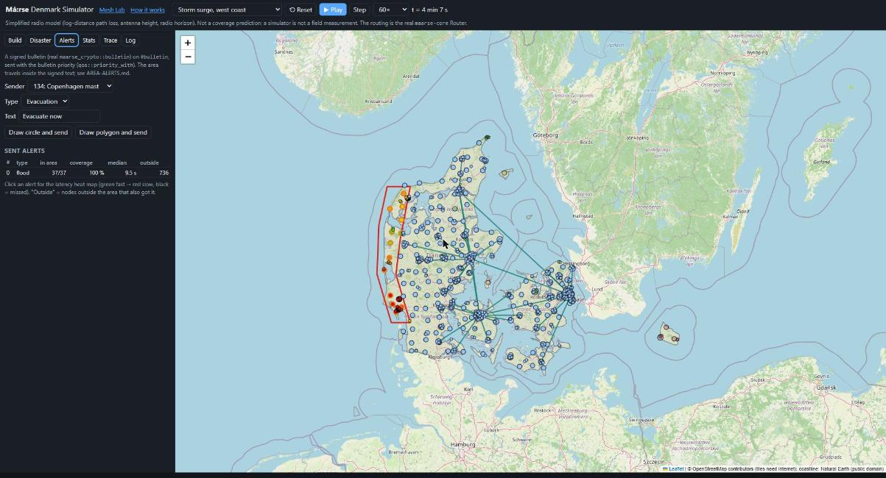

# Må:rse Denmark Simulator

Build and break a national Må:rse network in the browser. Every node runs the
**real `maarse_core::Router`** (the same code as the firmware), compiled to
WebAssembly. Only the radio, power and backbone around the routers are simulated.

> Simplified radio model. It is not a coverage prediction, and a simulator is not
> a field measurement.




## Build and open

```sh
rustup target add wasm32-unknown-unknown      # once
python tools/build_denmark_sim.py             # -> docs/denmark/maarse_sim_wasm.wasm
python -m http.server -d docs 8000            # browsers do not load .wasm from file://
# open http://localhost:8000/denmark/          (presets: #normal #internet_loss #bornholm #storm #e45 #forest #festival #spam)
node tools/denmark_sim_test.mjs               # headless test (needs the built .wasm)
cargo test -p maarse-sim-wasm                 # the engine's native tests
```

Map tiles come from OpenStreetMap (internet needed). The Denmark coastline is
embedded (`dk-land.js`), so land/sea, islands and node generation work offline.

## Design

### Layers

```
docs/denmark/app.js        map editor, controls, views (Leaflet 1.9.4)
docs/denmark/scenarios.js  Denmark generator + presets  -> scenario JSON
docs/denmark/maarse-sim.js JSON in / JSON out wrapper for the .wasm
maarse-sim-wasm            engine: radio, queues, power, backbone, timeline, trace
  maarse_sim::radio        path loss and SNR limits, shared with the maarse-sim CLI
  maarse_core::Router      unchanged, one per node
  maarse_crypto::bulletin  real signed bulletins for area alerts
```

### Why a new engine module instead of moving the CLI engine

The CLI engine (`maarse-sim/src/main.rs`) is built around a dense N×N gain
matrix and scenario flags (forest, hill, highway, bridge variants) woven through
it. Moving it unchanged into a library would not give a national map (N² links
for 2,000 nodes, no coordinates, no per-node height/SF/battery), and reshaping
it risks changing the CLI's numbers, which must stay identical. So:

* the **radio model** moved to `maarse-sim/src/radio.rs` (library) and both use
  it; the CLI's output is byte-identical for the same seed and flags;
* the Denmark engine (`maarse-sim-wasm/src/engine.rs`) is a new event loop that
  copies the CLI's **rules** one to one: CAD with 100–600 ms backoff and 8 tries,
  `DutyCycle` with a 120 s give-up, the collision rule (an overlapping signal that
  is decodable at SNR − 6 dB and less than 6 dB weaker kills the packet),
  half-duplex, slot jitter, `note_airtime` for load control, and the neighbour
  seeding the CLI does instead of real neighbour announces.

What it adds: sparse links via a spatial grid (only pairs within radio horizon
and interference range are stored), a send queue per node ordered by
`qos::priority_with(packet, #bulletin)` (the firmware has a queue; the CLI does
not model one), per-node SF, antenna height, batteries, power cuts, backbone
links and timeline events.

### No wasm-bindgen

The module exports five C functions (`buf_alloc`, `out_ptr`, `out_len`,
`sim_create`, `sim_call`, `sim_free`) and passes JSON through one buffer.
That needs no generated glue and no `wasm-bindgen-cli` whose version must match
the crate, works the same in Node and the browser, and costs little because
calls are coarse (one `step` per frame). `getrandom` gets a failing custom
backend: the engine always seeds its RNG from the scenario.

### Radio model (crude, honest)

* Path loss: `maarse_sim::radio` (log-distance, n = 3, 868 MHz), thermal noise
  + 6 dB, SNR limit per SF. Same numbers as the CLI.
* Antenna gain: 6 dB for fixed stations (repeater, anchor, host, Wi-Fi node),
  like the CLI's `--repeater-gain`.
* Height gain: +10 dB per decade above 1.5 m (handheld 1.5 m, relay 2 m,
  repeater 15 m, host 10 m, Wi-Fi node 6 m, mast/anchor 40 m; editable).
* Radio horizon: no link beyond `4.12 km × (√h1 + √h2)`.
* Nodes on different SFs do not hear each other.
* No terrain, no buildings, no land/sea difference in loss, no fading.

### Power

Mains nodes (repeater, anchor, host, Wi-Fi) fall back to their battery in a
power cut; nodes without a battery die. Battery nodes drain their idle power
(handheld 0.05 W, repeater 0.4 W, host 6 W) and the router's `energy` follows
the charge (Full > 60 %, Ok > 30 %, Low > 10 %, else Critical), so energy-aware
flood delays in the router apply. A host in a power cut loses its internet.

### Backbone

Like maarse-host: a host sends every packet it transmits to all its working
links too (TCP 40 ms, Wi-Fi point-to-point 5 ms), and the peer's router receives
it with SNR 10 dB. Floods with a region go only to peers that serve the region.
A TCP link works only while both ends have power and internet (global, per
region, per node); a Wi-Fi link needs only both ends alive.

### Scenario JSON

```jsonc
{
  "name": "…", "seed": 1, "sf": 9, "duty_permille": 100, "tx_dbm": 20, "duration_s": 1800,
  "features": { "carry": false, "local_repair": true, "backbone": true, "regions": false,
                "sf_slot": false, "scale_timeouts": false, "load_control": false, "area_scope": false },
  "nodes": [ { "kind": "repeater", "lat": 56.1, "lon": 9.5, "h": 0, "sf": 0, "battery_wh": -1,
               "mains": null, "carry": 0, "internet": null, "region": "midtjylland",
               "route": [], "speed_kmh": 0, "label": "" } ],
  "links": [ { "a": 0, "b": 1, "kind": "tcp", "up": true } ],
  "traffic": { "direct_per_min": 6, "channel_per_min": 1, "local_share": 0.8, "local_km": 25,
               "start_s": 5, "stop_s": 0, "spammers": [], "spam_per_min": 0 },
  "events": [ { "t_s": 120, "type": "internet_down", "region": "" },
              { "t_s": 150, "type": "alert", "from": 3, "alert": "flood",
                "area": { "polygon": [[56.0, 8.1], [56.0, 8.6], [55.5, 8.6]] }, "text": "…" } ]
}
```

`kind`: handheld, relay, repeater, anchor, host, wifi, mobile. Zero / null /
negative values mean "default for the kind". Event types: `internet_down`,
`internet_up` (optional `region`), `power_cut` (`area`), `power_restore`,
`kill_random` (`n`, `node_kind`), `kill` (`node`), `revive`, `link`
(`index`, `up`), `alert`, `announce` (`node`), `set_traffic` (`traffic`).

### Event trace

The engine writes the CLI's `--trace-json` events (`tx`, `rx`, `defer`, `send`,
`deliver`, `ack`) and extends them: every packet carries its packet id (`pid`)
and, through *causal tagging*, the message (`msg`) or alert (`alert`) that
caused it (a packet sent while a router handles a tagged packet inherits the
tag), plus `cancel` (flood suppression), `drop` (duty, busy, quota, area),
`route`, `bb` (backbone), `repair`, `carry`, `retry`, `alert_rx`, `announce`,
`event`, `dead`. Follow, reach, animation and the log are all views of this
one stream. It keeps the last 400,000 lines (older ones are dropped).

Flood reach (`reach`): for one packet id, every node that decoded it, its hop
count, and why it did not forward: forwarded / suppressed (neighbours covered
the area) / role does not forward / outside region / hop limit / dropped (duty,
busy, quota, area scope) / not forwarded (duplicate or not needed).

## What the UI does

* **Build**: place and drag handhelds, relays, repeaters, anchors, hosts,
  ESP32 Wi-Fi nodes and cars (draw a route), delete, draw TCP and Wi-Fi links
  (click a link to switch it). The inspector edits kind, SF, height, battery,
  carry copies, internet and region. Feature switches, SF, duty cycle, traffic.
  Export/import the scenario JSON.
* **Generate Denmark**: sliders for users, repeater spacing, % hosts with
  internet and seed. Repeaters on a jittered grid on land (plus one per small
  island town), masts in towns over 50,000, a host per town over 12,000 (TCP star
  to the nearest of the four big cities, which are meshed), users weighted by
  population^0.8 around ~100 towns (`dk-towns.js`, rounded figures). Nodes are
  coloured by radio component, so isolated islands show at once.
* **Disaster**: internet down (all / region), power cut in a drawn polygon,
  power back, kill N random repeaters, revive, toggle a backbone link. Applied
  now and recorded on the timeline; edit times and Reset to replay.
* **Alerts**: pick a sender and type, draw a circle or polygon, send. Per alert:
  coverage of live nodes inside, latency median/p90, nodes outside that also got
  it, and a latency heat map.
* **Stats**: delivered %, acked %, latency, channel reach, airtime, collisions,
  duty-cycle hits, drops, local repairs, carry, backbone packets, queue delay per
  priority, transmissions per type. **Compare**: run the scenario twice with one
  feature flipped and see both results side by side.
* **Trace**: packet animation (per type, collisions as red rings), message list,
  follow one message (path request flood, path response, data hops, acks,
  backbone, repairs, carry, timeline table), path request / announce / alert reach.
* **Log**: filter by node, packet type, message and event; export JSON or CSV.
* **Inspector**: role, state, battery and energy, internet, slot, airtime,
  duty budget used, router stats, router neighbour table (SNR, last heard, role),
  route table, send queue with priorities, backbone links.

Presets: national normal day, total internet loss, Bornholm cut off, storm surge
on the west coast with power cut, E45 drive (repeaters every 15 km, carry on),
group in the forest (Rold Skov, walkers with relays, relay on a hill), Roskilde
festival, spam attack.

## Simplified or missing

* Radio: see above. No terrain profile, so "the hill" is just a 20 m antenna.
* Announces are sent on demand (button / `announce` event) with a real stamp
  and real size, but an unsigned body; the router does not verify signatures.
  Neighbour roles are seeded every 60 s, as in the CLI.
* No encryption of chat payloads (the router does not need it); bulletins are
  really signed and verified.
* Walkers and cars move along polylines (back and forth), not on roads.
* Energy: idle draw only; transmit energy is not subtracted.
* The forest attenuation of `maarse-sim --forest` is not modelled.
* Mailbox / DHT (maarse-host) is not part of the router and not simulated.
* Changing the scenario restarts the run at t = 0; live disaster actions are
  injected without a restart and recorded on the timeline.
* Dead hops in the router are private and not shown in the inspector.
