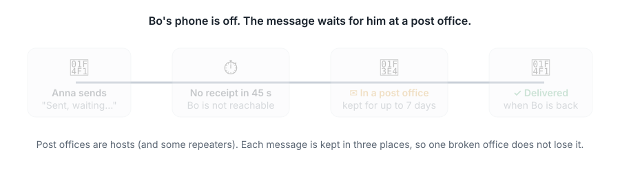

# Send en besked

Skriv til nogen, og Må:rse finder en vej til dem: over radio, over
internettet eller begge dele. Hvis de ikke kan nås lige nu, venter beskeden
på dem.

## Sådan gør du

| | Android-app | Webklient (pc) |
|---|---|---|
| 1 | Åbn **Chats** og tryk på blyanten, eller åbn en kontakt under **Noder** og tryk på **Besked** | Klik på personen i listen til venstre |
| 2 | Skriv og tryk på **Send** | Skriv i *Skriv en besked* og tryk på **Enter** |
| 3 | Se linjen under beskeden (se nedenfor) | Den samme linje under beskeden |

En besked kan være op til ca. 150 tegn over radio. Længere tekst, billeder og
tale sendes som filer (se [Filer, billeder og tale](files.md)).

## Hvad linjen under din besked betyder

| Du ser | Hvad det betyder | Skal du gøre noget? |
|---|---|---|
| Sendt, venter på kvittering | Den er på vej. | Nej. |
| ✓ Leveret | Den nåede den anden persons enhed. | Nej. |
| ✓ Leveret (båret af andre) | Der var ingen direkte vej, så andres enheder bar den derhen (se [Bæring](carry.md)). | Nej. |
| ✉ Venter på et posthus | Den anden person kan ikke nås lige nu. Beskeden gemmes og afleveres, så snart de er tilbage. | Nej. Den kommer af sig selv. |
| Venter — ingen forbindelse | *Din* telefon har ingen forbindelse (ingen radio, intet internet). Den sendes, så snart du er tilbage. | Tjek din radio eller dit internet. |
| Fejl: … | Den kunne ikke sendes, og teksten siger hvorfor. | Læs teksten; prøv som regel igen senere. |

Beskeder i en **kanal** går til alle i den, så ingen sender en kvittering.
Der ser du kun *Sendt til kanalen*.

## Når den anden person er væk

Telefoner løber tør for batteri, folk kommer uden for rækkevidde, og
nogle gange er et radiolink nede. Må:rse giver ikke op:

**Eksempel.** Anna i Skagen skriver til Bo, der er på en båd uden dækning.
Efter 45 sekunder uden kvittering går hendes besked til et posthus. Annas
telefon viser *✉ Venter på et posthus*, og hun kan slukke den. To dage senere
kommer Bo inden for rækkevidde igen, hans telefon spørger "er der post til
mig?", og beskeden kommer frem. Annas telefon viser så *✓ Leveret*.

Godt at vide:

- Et posthus gemmer beskeder i **7 dage**.
- En vært kan gemme kopier på op til tre replika-pladser. Tilgængelighed,
  kvote og vellykket lagring afgør, hvor mange kopier der faktisk findes.
- Hvis din telefons forbindelse til dens radio falder ud et stykke tid
  (fx Bluetooth uden for rækkevidde), lader radioen ikke, som om den har
  leveret beskeder til dig. De venter på posthuset, og du får dem, når din
  telefon forbinder igen.

## Hvordan finder den vej?

Du behøver ikke vide det for at bruge Må:rse, men det forklarer, hvorfor det
virker godt, selv med mange brugere:

1. **Den første besked leder efter en rute.** Den spørger netværket "hvem kan
   nå Bo?", og den bedste vej huskes.
2. **De næste beskeder følger den rute.** Kun enhederne på vejen sender, så
   radioen er fri til alle andre.
3. **Hvert trin tjekkes.** Går en besked tabt mellem to repeatere, gentages
   kun det trin, ikke hele vejen fra Anna.
4. **Radio og internet er ét netværk.** Hvor en vært har internet, kan
   beskeden springe tværs over landet på et øjeblik og så fortsætte over radio.

## Prøv det

[Danmarkssimulatoren](https://trixxor.github.io/maarse/denmark/) viser alt
dette på et kort over Danmark, med Må:rses rigtige routingkode:

- **Send › Send og følg**: vælg to byer og se en besked rejse.
- Forvalget **[Bornholm for sig selv](https://trixxor.github.io/maarse/denmark/#bornholm_alone)**:
  Bornholm er afskåret; en besked fra København venter på et posthus og
  kommer frem, når øen er forbundet igen.
- Forvalget **[Posthuset dør, en kopi leverer](https://trixxor.github.io/maarse/denmark/#office_failure)**:
  én af de tre kopier kommer stadig igennem.

## Grænser

- Over radio er en besked kort (ca. 150 tegn).
- Hvis ingen har et posthus inden for rækkevidde (ingen vært, ingen repeater
  med et) og ingen bærer den, venter beskeden i stedet på Annas telefon.
- *Leveret* betyder, at den nåede Bos enhed. Om Bo har læst den, vises ikke.

---
Se også: [Kontakter og navne](contacts.md) · [Kanaler](channels.md) ·
[Sikkerhedsnumre](safety-numbers.md) · [For nysgerrige: protokollen](../../protocol-spec.md)
