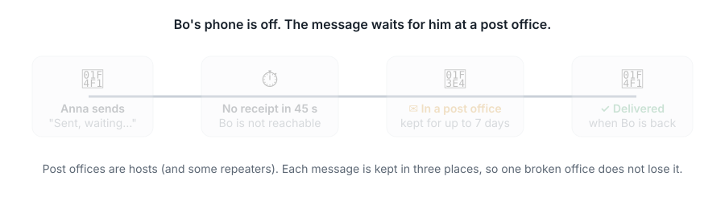

# Posthuse: beskeder, der venter på dig

Når den, du skriver til, ikke kan nås (telefonen er slukket, uden for
rækkevidde, et link er nede), går din besked ikke tabt. Den afleveres på et
**posthus** og venter der, til de er tilbage, som et brev, der venter på
posthuset, til man henter det.

Du behøver ikke gøre noget. Det sker af sig selv, på begge sider.

## Hvad du ser

**Som afsender** fortæller linjen under din besked, hvor den er:

| Du ser | Betydning |
|---|---|
| Sendt, venter på kvittering | Må:rse prøver stadig at nå dem direkte. |
| ✉ Venter på et posthus | De kunne ikke nås i 45 sekunder, så beskeden blev afleveret. Du kan slukke din telefon; den har ikke brug for dig mere. |
| ✓ Leveret | De kom tilbage og fik den. |

**Som modtager** får du bare beskeden, når du er tilbage. Den vises på det
tidspunkt, den kommer, i den rigtige samtale.

## Fra aflevering til levering

### 1. Aflevering og kopier

Annas telefon giver beskeden til det **nærmeste posthus**, den kan nå. Det
posthus kan sende kopier til egnede posthuse over backbonen. Værten udpeger
op til tre replika-pladser ud fra Bos adresse. Hvor mange kopier der gemmes,
afhænger af tilgængelige værter, kvoter og vellykkede skrivninger.

### 2. Venten

Beskeden gemmes i op til **7 dage**. Imens posthuset:

- fortæller området omkring sig "jeg har post til Bo" i de små signaler, det
  alligevel sender, så Bos telefon opdager det, så snart den er inden for
  rækkevidde, og
- prøver at aflevere den af sig selv en gang imellem, hvis Bo kan nås, men
  ikke har spurgt.

### 3. Afhentning

Bos telefon spørger "er der post til mig?":

- når den starter,
- når den er tilbage i dækning eller finder et nyt posthus,
- når et posthus siger, at det har post til ham, og
- alligevel hver få timer.

Det posthus, Bo spørger, behøver ikke være det, Anna afleverede til. Det kan
hente en kopi til ham. Efter de nuværende værtsregler kan en kopi på en anden
replika blive liggende til udløb efter leveringen.

## Et eksempel

> Anna bor i Skagen. Hendes bror Bo er sejlet til Anholt, uden for rækkevidde
> af alt.
>
> Fredag aften skriver Anna *"Mors fødselsdag er flyttet til søndag"*. Efter
> 45 sekunder viser hendes telefon *✉ Venter på et posthus*. Værten i
> Frederikshavn har taget den, og der gemmes kopier i Aarhus, Odense og
> København.
>
> Søndag morgen sejler Bo ind i Grenaa. Hans telefon hører en repeater, spørger
> efter post, og posthuset i Aarhus giver ham Annas besked. Annas telefon
> skifter til *✓ Leveret*. Andre replikaer kan beholde forseglede kopier,
> til deres opbevaringstid udløber.

## Er det privat?

Den sendende node forsegler beskeden til Bo, før den afleveres. Et posthus kan
se modtager og trafikmetadata og håndterer kun chiffertekst. Statisk offline
post har ikke forward secrecy mod et senere brud på modtagerens langtidsnøgle.
Godkendelse af modtageren ved hentning fra en replika er stadig under udvikling.

## Hvem driver posthusene?

**Værter**: en pc, en server eller en telefon, der kører maarse-host. Hver vært
er et posthus, medmindre ejeren slår det fra. Nogle repeatere kan også gemme
nogle få beskeder.

Hvis du kører en vært:

| Indstilling | Hvad den gør |
|---|---|
| *(ingenting)* | Din vært er også posthus for andre. Det er standard, og det hjælper alle. |
| `--mail-quota-mb 200` | Gem højst 200 MB post til andre. |
| `--no-post-office` | Gem ikke post til andre. Din egen post virker stadig. |

En vært gemmer højst 100 ventende beskeder pr. modtager, så ingen kan fylde
den med post til én person.

## Din telefon og dens radio

Hvis din telefon bruger en radio over Bluetooth og mister forbindelsen et
stykke tid (den ligger fx i lommen uden for rækkevidde), tager radioen
**ikke** imod beskeder på dine vegne. Afsendere ser *Venter på et posthus*, og
du får beskederne, når din telefon forbinder igen. Intet går tabt imens.

## Med én konto på flere enheder

Hvis du har [én konto på flere enheder](accounts.md), gemmer posthuset din post
**til dig**, ikke til én enhed. Den af dine enheder, der spørger først, får
den, og de andre får kopier.

## Prøv det

I [Danmarkssimulatoren](https://trixxor.github.io/maarse/denmark/):

- **[Bornholm for sig selv](https://trixxor.github.io/maarse/denmark/#bornholm_alone)**:
  Bornholm er afskåret i 15 minutter. En besked fra København venter på et
  posthus og kommer frem, når øen er forbundet igen.
- **[Posthuset dør, en kopi leverer](https://trixxor.github.io/maarse/denmark/#office_failure)**:
  Aalborg-værterne dør, mens de har en besked til en i Odense, og en af de
  andre kopier leverer den alligevel.
- Tilføj to telefoner under **Telefoner**, sluk den ene (×, eller knappen ↺
  "mist denne enhed") og skriv til den fra den anden. Se status skifte til
  *✉ Venter på et posthus* og så til *✓ Leveret*, når den kommer tilbage.

## Grænser

- Efter **7 dage** smides en uleveret besked væk.
- Hvis intet posthus kan nås fra afsenderen (ingen vært og ingen repeater med
  et posthus), venter beskeden i stedet på afsenderens telefon og sendes, når
  en vej åbner sig.
- *Leveret* betyder, at den nåede modtagerens enhed, ikke at de har læst den.

---
Se også: [Send en besked](messages.md) · [Bæring](carry.md) ·
[Én konto på flere enheder](accounts.md) ·
[For nysgerrige: postkasser i protokollen](../../protocol-spec.md#8-mailboxes-and-the-backbone)
