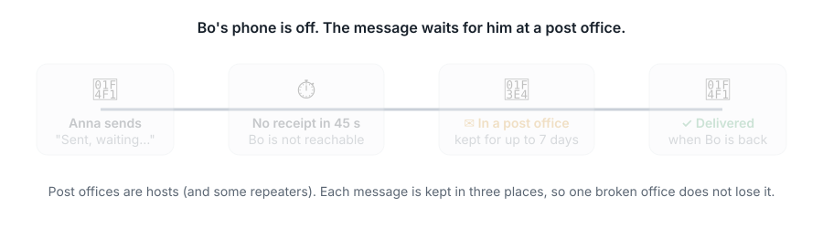

# Sending a message

Write to someone, and Må:rse finds a way to them: over radio, over the
internet, or both. If they are not reachable right now, the message waits
for them.

## How to do it

| | Android app | Web client (PC) |
|---|---|---|
| 1 | Open **Chats** and tap the pencil, or open a contact under **Nodes** and tap **Message** | Click the person in the list on the left |
| 2 | Type and tap **Send** | Type in *Write a message* and press **Enter** |
| 3 | Watch the line under the message (see below) | The same line under the message |

A message can be up to about 150 characters over radio. Longer text,
pictures and voice go as files (see [Files, pictures and voice](files.md)).

## What the line under your message means

| You see | What it means | Do you need to do anything? |
|---|---|---|
| Sent, waiting for receipt | It is on its way. | No. |
| ✓ Delivered | It reached the other person's device. | No. |
| ✓ Delivered (carried by others) | There was no direct way, so other people's devices carried it there (see [Carrying](carry.md)). | No. |
| ✉ Waiting in a post office | The other person is not reachable right now. The message is kept and handed over as soon as they are back. | No. It arrives by itself. |
| Waiting — no connection | *Your* phone has no connection (no radio, no internet). It is sent as soon as you are back. | Check your radio or internet. |
| Error: … | It could not be sent, and the text says why. | Read the text; usually try again later. |

Messages in a **channel** go to everyone in it, so nobody sends a receipt.
There you only see *Sent to the channel*.

## When the other person is away

Phones run out of battery, people go out of range, and sometimes a radio
link is down. Må:rse does not give up:

**Example.** Anna in Skagen writes to Bo, who is on a boat without
coverage. After 45 seconds without a receipt, her message goes to a post
office. Anna's phone shows *✉ Waiting in a post office*, and she can turn it
off. Two days later Bo comes back into range, his phone asks "is there mail
for me?", and the message arrives. Anna's phone then shows *✓ Delivered*.

Good to know:

- A post office keeps messages for **7 days**.
- Every message is kept in **three** post offices, so one broken office does
  not lose it.
- If your phone's connection to its radio drops for a while (Bluetooth out
  of range, say), the radio does not pretend it delivered messages to you.
  They wait at the post office, and you get them when your phone reconnects.

## How does it find the way?

You do not need to know this to use Må:rse, but it explains why it works
well even with many users:

1. **The first message looks for a route.** It asks the network "who can
   reach Bo?", and the best way is remembered.
2. **The next messages follow that route.** Only the devices on the way
   send, so the radio stays free for everyone else.
3. **Every step is checked.** If a message is lost between two repeaters,
   only that step is repeated, not the whole way from Anna.
4. **Radio and internet are one network.** Where a host has internet, the
   message can jump across the country in a moment, then continue by radio.

## Try it

The [Denmark simulator](https://trixxor.github.io/maarse/denmark/) shows
all of this on a map of Denmark, running Må:rse's real routing code:

- **Send › Send and follow**: pick two towns and watch a message travel.
- Preset **[Bornholm on its own](https://trixxor.github.io/maarse/denmark/#bornholm_alone)**:
  Bornholm is cut off; a message from Copenhagen waits at a post office
  and arrives when the island is connected again.
- Preset **[Post office dies, a copy delivers](https://trixxor.github.io/maarse/denmark/#office_failure)**:
  one of the three copies still gets through.

## Limits

- Over radio a message is short (about 150 characters).
- If nobody has a post office within reach (no host, no repeater with one)
  and nobody carries it, the message waits on Anna's phone instead.
- *Delivered* means it reached Bo's device. Whether Bo has read it is not
  shown.

---
Related: [Contacts and names](contacts.md) · [Channels](channels.md) ·
[Safety numbers](safety-numbers.md) · [For the curious: the protocol](../protocol-spec.md)
