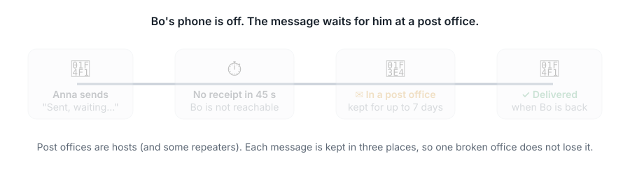

# Post offices: messages that wait for you

When the person you write to is not reachable (phone off, out of range, a
link down), your message is not lost. It is posted at a **post office** and
waits there until they are back, like a letter that waits at the post
office until you pick it up.

You do not have to do anything. It happens by itself, on both sides.

## What you see

**As the sender**, the line under your message tells you where it is:

| You see | Meaning |
|---|---|
| Sent, waiting for receipt | Må:rse is still trying to reach them directly. |
| ✉ Waiting in a post office | They were not reachable for 45 seconds, so the message was posted. You can turn your phone off; it no longer needs you. |
| ✓ Delivered | They came back and got it. |

**As the recipient**, you simply get the message when you are back. It is
shown at the time it arrives, in the right conversation.

## From posting to delivery

### 1. Posting: nearby, and in three copies

Anna's phone hands the message to the **nearest post office** it can
reach. That office sends **copies to three post offices** across the
network. Which three is worked out from Bo's address, so every post office
in the country can work out where Bo's mail is, wherever Bo turns up.

### 2. Waiting

The message is kept for up to **7 days**. Meanwhile the post office:

- tells the area around it "I have mail for Bo" in the small signals it
  sends anyway, so Bo's phone notices as soon as it is in range, and
- tries to hand it over by itself now and then, in case Bo is reachable
  but did not ask.

### 3. Picking up

Bo's phone asks "any mail for me?":

- when it starts,
- when it is back in coverage or finds a new post office,
- when a post office says it has mail for him, and
- every few hours anyway.

The post office Bo asks does not have to be the one Anna posted at. It
fetches the copy for him. When Bo has the message, **all copies are
deleted**.

## An example

> Anna lives in Skagen. Her brother Bo has gone sailing to Anholt, out of
> range of everything.
>
> On Friday evening Anna writes *"Mum's birthday is moved to Sunday"*. After
> 45 seconds her phone shows *✉ Waiting in a post office*. The host in
> Frederikshavn has taken it, and copies are kept in Aarhus, Odense and
> Copenhagen.
>
> On Sunday morning Bo sails into Grenaa. His phone hears a repeater, asks
> for mail, and the post office in Aarhus hands him Anna's message. Anna's
> phone changes to *✓ Delivered*. The copies in Frederikshavn, Odense and
> Copenhagen are deleted.

## Is it private?

Yes. The message is locked for Bo **before** it leaves Anna's phone. The
post office keeps a locked envelope: it can see who it is for, but not what
it says. Only Bo's device can open it.

## Who runs the post offices?

**Hosts**: a PC, a server or a phone running maarse-host. Every host is a
post office unless its owner turns it off. Some repeaters can also keep a
few messages.

If you run a host:

| Setting | What it does |
|---|---|
| *(nothing)* | Your host is a post office for others too. That is the default, and it helps everyone. |
| `--mail-quota-mb 200` | Keep at most 200 MB of mail for others. |
| `--no-post-office` | Do not keep mail for others. Your own mail still works. |

A host keeps at most 100 waiting messages per recipient, so nobody can fill
it with mail for one person.

## Your phone and its radio

If your phone uses a radio over Bluetooth and loses the connection for a
while (it is in your pocket out of range, say), the radio does **not**
accept messages on your behalf. Senders see *Waiting in a post office*, and
you get the messages when your phone reconnects. Nothing is lost in
between.

## With one account on several devices

If you have [one account on several devices](accounts.md), the post office
keeps your mail **for you**, not for one device. Whichever of your devices
asks first gets it, and the others get copies.

## Try it

In the [Denmark simulator](https://trixxor.github.io/maarse/denmark/):

- **[Bornholm on its own](https://trixxor.github.io/maarse/denmark/#bornholm_alone)**:
  Bornholm is cut off for 15 minutes. A message from Copenhagen waits at a
  post office and arrives after the island is connected again.
- **[Post office dies, a copy delivers](https://trixxor.github.io/maarse/denmark/#office_failure)**:
  the Aalborg hosts die while they hold a message for someone in Odense,
  and one of the other copies still delivers it.
- Add two phones under **Phones**, switch one off (×, or the ↺ "lose this
  device" button) and write to it from the other. Watch the status change
  to *✉ Waiting in a post office*, then to *✓ Delivered* when it comes back.

## Limits

- After **7 days** an undelivered message is thrown away.
- If no post office is within reach of the sender (no host and no repeater
  with a post office), the message waits on the sender's phone instead and
  is sent when a way opens.
- *Delivered* means it reached the recipient's device, not that they have
  read it.

---
Related: [Sending a message](messages.md) · [Carrying](carry.md) ·
[One account on several devices](accounts.md) ·
[For the curious: mailboxes in the protocol](../protocol-spec.md#8-mailboxes-and-the-backbone)
